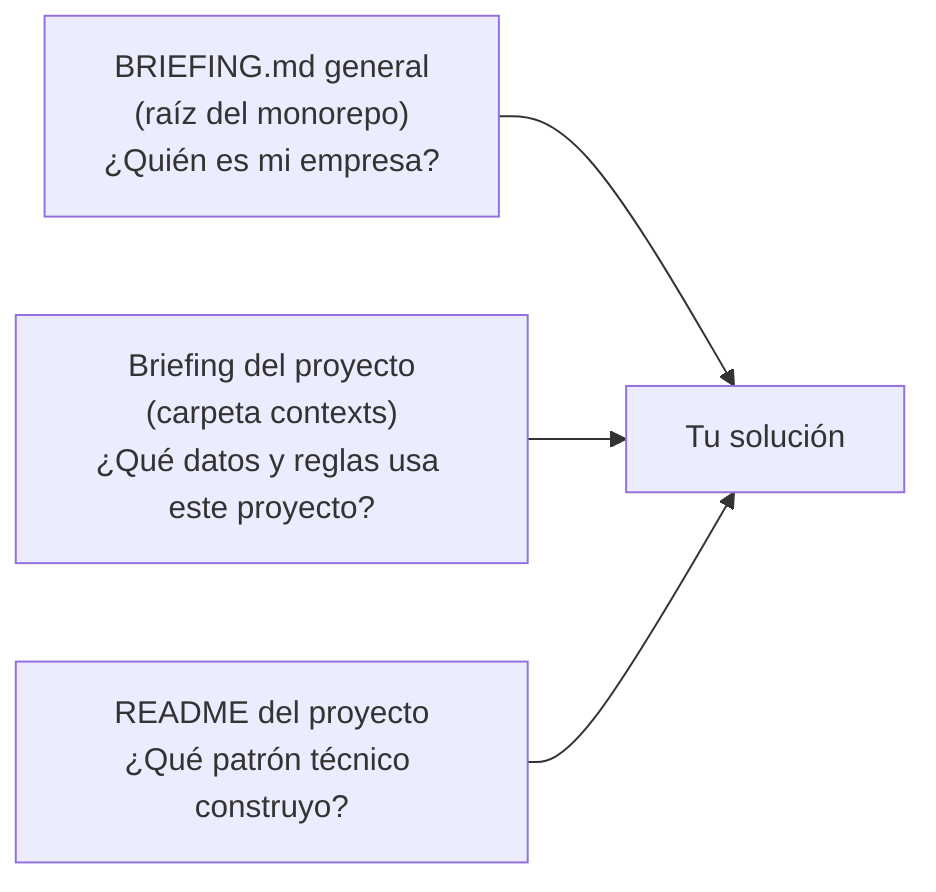

# Proyectos de la compañía y el monorepo

<!-- hide -->

_These instructions are also available in [English](https://github.com/4GeeksAcademy/ai-engineering-syllabus/blob/main/content/lessons/company-projects-and-monorepo/company-projects-and-monorepo.md)._

<!-- endhide -->

En la lección [Cómo están estructurados los proyectos](https://github.com/4GeeksAcademy/ai-engineering-syllabus/blob/main/content/lessons/how-projects-are-structured/how-projects-are-structured.es.md) viste las cinco secciones que tiene cualquier proyecto del curso y cómo trabajarlas con tu agente en **Ask → Plan → Agent**. Esta lección da eso por sabido y suma una capa más.

Muchos proyectos del curso son **proyectos de la compañía**: se construyen dentro de **tu empresa**. No tienes que adivinar cuáles son: el README de cada proyecto **siempre lo indica**. Cuando lo veas, ya sabes que tienes que trabajar sobre el monorepo de tu empresa y tener en cuenta sus briefings.

## Qué vas a lograr

- Entender qué es el **monorepo** de tu empresa y por qué no es una sola aplicación, sino un ecosistema.
- Saber que el monorepo es una **práctica real** de la industria, no solo un recurso académico.
- Distinguir los **dos niveles de briefing**: el general de tu empresa y el de cada proyecto.
- Leer el **ticket del tech lead** y ubicar los **milestones** dentro del curso.
- Saber **qué cambia en cada sección** del README cuando el proyecto es de la compañía.

## Una empresa, un monorepo, todo el curso

Al principio del curso eliges una empresa ficticia. A partir de ahí, todos los proyectos de la compañía se construyen sobre **un único repositorio**: tu copia del [monorepo de la empresa](https://github.com/4GeeksAcademy/ai-engineering-company-project-monorepo). Un monorepo es un repositorio que contiene varias partes de un mismo sistema (web, backoffice, APIs, agentes, pipelines de datos…) en un solo lugar.

## Un monorepo no es una aplicación: es un ecosistema

Este punto confunde mucho al principio. Un monorepo **no es una sola aplicación** con un `index.html` o un `main.py` en la raíz. Es un **ecosistema**: varias aplicaciones y piezas independientes que conviven en el mismo repositorio, cada una en su propia carpeta y con su propia responsabilidad.

La estructura de tu monorepo será parecida a esta (los nombres exactos pueden variar):

```text
mi-empresa-monorepo/
├── BRIEFING.md        ← el contexto de tu empresa
├── AGENTS.md          ← las reglas para tu agente de código
├── memory-bank/       ← la memoria del proyecto para los agentes
├── docs/              ← documentación técnica y de negocio
├── uis/               ← las interfaces de usuario
│   ├── web/           ← la web pública de la empresa
│   └── backoffice/    ← la herramienta interna del equipo
├── services/          ← las APIs y servicios de backend
├── data/              ← datos y pipelines de datos
├── scripts/           ← procesos independientes (cronjobs, utilidades)
└── packages/          ← código compartido entre las demás partes
```

Fíjate en lo que **no** hay en la raíz: ni un `index.html`, ni un `app.py`, ni un `styles.css`. La raíz es como el **recibidor de un edificio**: ahí está la información general (el `BRIEFING.md`, las reglas, la documentación) y desde ahí se llega a cada apartamento. Cada aplicación vive en su propia carpeta.

## ¿Usar un monorepo es una mala práctica?

No. Es una forma de organizar el código tan válida como otras, y la usan empresas muy grandes: Google, Meta, Microsoft o Uber guardan gran parte de su código en monorepos. Incluso hay herramientas pensadas específicamente para trabajar con ellos, como Nx o Turborepo.

La alternativa más común es el **polyrepo**: un repositorio distinto para cada aplicación o servicio. Ninguna de las dos opciones es "la correcta". Cada equipo elige según su tamaño, cómo se coordina y cómo despliega.

En este curso, el monorepo tiene además un **fin académico**: te permite ver todo el sistema de tu empresa en un solo lugar, entender cómo se conectan sus piezas y llevarlo al final del curso como un proyecto completo para tu portafolio. Pero que tenga un propósito académico no significa que sea algo artificial: es una solución que existe y se usa en el mundo real, y vas a encontrártela en tu trabajo.

## Qué significa trabajar siempre en el mismo monorepo

Esto significa que:

- **No creas un repositorio nuevo** por proyecto. Siempre trabajas sobre tu misma copia.
- Cada proyecto **construye sobre lo anterior**. Si un proyecto dice "ya deberías tener la autenticación", es porque un proyecto previo la creó en ese mismo monorepo.
- Al final del curso, todo ese trabajo forma **un sistema completo** que podrás enseñar en tu portafolio.

Lo verás en el reto con un aviso como este:

> 📌 Estás construyendo sobre **tu copia** del **monorepo** de la empresa seleccionada al inicio del curso — no en un repositorio nuevo.

## Los briefings: el contexto de tu empresa

Todos los estudiantes resuelven los **mismos retos técnicos**, pero cada uno con los **datos y nombres de su empresa**. Ese contexto vive en los **briefings**, y hay dos niveles:

**1. El briefing general de tu empresa (`BRIEFING.md` en la raíz del monorepo).** En el primer proyecto de la compañía, **Elige tu empresa**, lees los perfiles de las empresas disponibles, eliges una y copias su briefing general en la raíz de tu monorepo como `BRIEFING.md`, sustituyendo el archivo de ejemplo que trae la plantilla. Ese archivo describe tu empresa en conjunto: sector, departamentos, personajes, problemas y su hoja de ruta. Se queda ahí durante todo el curso y es la base de todo lo demás.

**2. El briefing de cada proyecto.** Además, cada proyecto de la compañía tiene **su propio briefing**, con el contexto específico de ese proyecto: los nombres exactos de entidades y campos, las reglas de negocio, los datos semilla, los valores esperados… Lo encontrarás al principio del README, en un aviso como este:

> **Antes de empezar**: lee tu **company-BRIEFING.md** antes de escribir código — define los nombres de campos, las categorías válidas y los valores semilla esperados para tu implementación.

Ese enlace te lleva a la carpeta [`contexts`](https://github.com/4GeeksAcademy/ai-engineering-syllabus/tree/main/content/contexts) del temario, donde cada proyecto tiene su carpeta con un briefing por empresa y por idioma (por ejemplo, `<tu-empresa>-BRIEFING.es.md`). Abre **solo el de tu empresa**.



Dicho de otra forma: el **README** describe el patrón técnico que todos construyen, el **briefing general** te dice quién es tu empresa y el **briefing del proyecto** pone los detalles concretos que tu solución tiene que respetar. Por eso los proyectos dicen cosas como "define la entidad equivalente a producto según tu briefing".

> ⚠️ Una solución genérica que ignore tu empresa no se acepta. Antes de planificar con el agente, dale como contexto **los dos briefings**: el general y el del proyecto.

## El ticket o el brief del tech lead

En los proyectos de la compañía, **🎯 Tu reto** suele venir escrito como en un equipo real: un **ticket** (por ejemplo, `Ticket #DEV-53`) o un **brief de tu tech lead**, con **criterios de aceptación**. Léelo como lo leería un ingeniero en su trabajo: ¿qué se pide?, ¿qué condiciones tiene que cumplir?, ¿qué decisiones ya están tomadas y cuáles me tocan a mí?

Los criterios de aceptación del ticket y la lista de **✅ Qué evaluaremos** van de la mano: los dos te describen el destino.

## Los milestones

Los **milestones** son los grandes hitos del proyecto de tu empresa: elegir la empresa, la web pública, el backend, el frontend, la base de conocimiento RAG, los flujos con agentes… Cada uno junta lo aprendido en los proyectos anteriores y lo convierte en una parte real del sistema de la empresa.

Entre milestone y milestone hay proyectos más pequeños (autenticación, telemetría, cronjobs, colas de mensajes…) que también viven en el mismo monorepo y preparan el terreno para el siguiente hito.

## Cómo cambian las secciones en un proyecto de la compañía

| Sección | Qué cambia |
| --- | --- |
| 🎯 Tu reto | Viene como ticket o brief, con criterios de aceptación y bloques de conocimiento complementario. Siempre se lee junto a tu `BRIEFING.md` general y el briefing del proyecto. |
| 🌱 Cómo empezar | Casi nunca creas un repositorio: abres tu monorepo, vas a la carpeta indicada (`uis/web/`, `services/`, `scripts/`…) y añades lo necesario. |
| 💻 Qué debes hacer | Indica dónde vive cada pieza dentro del monorepo. Los nombres concretos los pone el briefing del proyecto. |
| ✅ Qué evaluaremos | Incluye comprobar que tu solución respeta tu empresa (nombres, reglas, datos semilla). |
| 📦 Cómo entregar | Normalmente: trabajar en una rama, subir los cambios a **tu** copia, abrir un Pull Request y entregar la URL en la plataforma. |

## Checklist antes de empezar un proyecto de la compañía

- [ ] El README indica que es un proyecto de la compañía.
- [ ] Estoy trabajando en **mi** copia del monorepo, no en un repositorio nuevo.
- [ ] Sé en qué carpeta del monorepo vive lo que voy a construir.
- [ ] Tengo a mano mi `BRIEFING.md` general, en la raíz del monorepo.
- [ ] Leí el briefing de este proyecto para **mi** empresa, en la carpeta `contexts`.
- [ ] Le di **los dos briefings** a mi agente como contexto antes de planificar.

## Conclusión

Un proyecto de la compañía no es un ejercicio aislado: es una pieza más de **un sistema que vas construyendo durante todo el curso**. El monorepo es el lugar donde vive ese sistema, y los briefings son lo que lo hace **tuyo** y no una solución genérica.

Cada vez que abras un proyecto de la compañía, recuerda: mismo monorepo, cada pieza en su carpeta, los dos briefings como contexto y el ticket como lo leería un ingeniero de verdad.
