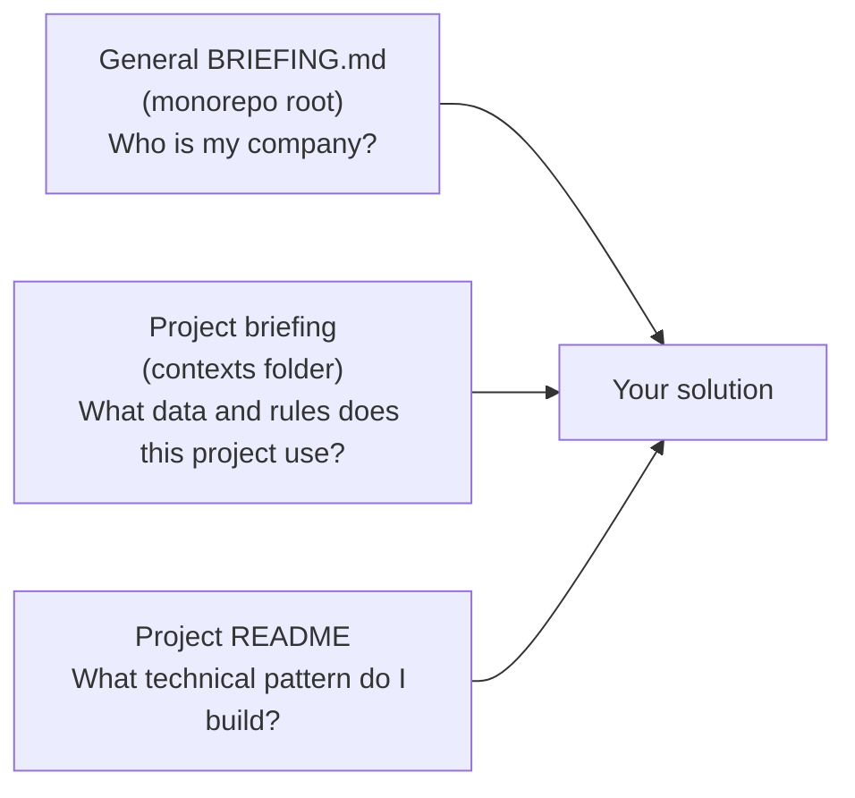

# Company projects and the monorepo

<!-- hide -->

_Estas instrucciones también están disponibles en [español](https://github.com/4GeeksAcademy/ai-engineering-syllabus/blob/main/content/lessons/company-projects-and-monorepo/company-projects-and-monorepo.es.md)._

<!-- endhide -->

In the lesson [How projects are structured](https://github.com/4GeeksAcademy/ai-engineering-syllabus/blob/main/content/lessons/how-projects-are-structured/how-projects-are-structured.md) you saw the five sections every course project has and how to work them with your agent through **Ask → Plan → Agent**. This lesson assumes you know that and adds one more layer.

Many projects in the course are **company projects**: they are built inside **your company**. You do not have to guess which ones they are: each project's README **always says so**. When you see it, you know you have to work on your company monorepo and take its briefings into account.

## What you will achieve

- Understand what your company **monorepo** is and why it is not a single application but an ecosystem.
- Know that the monorepo is a **real industry practice**, not just an academic device.
- Tell apart the **two briefing levels**: your company's general one and each project's.
- Read the **tech lead's ticket** and place the **milestones** within the course.
- Know **what changes in each README section** when the project is a company project.

## One company, one monorepo, the whole course

At the beginning of the course you choose a fictional company. From then on, every company project is built on **a single repository**: your copy of the [company monorepo](https://github.com/4GeeksAcademy/ai-engineering-company-project-monorepo). A monorepo is a repository that holds several parts of the same system (website, backoffice, APIs, agents, data pipelines…) in one place.

## A monorepo is not an application: it is an ecosystem

This point confuses a lot of people at first. A monorepo is **not a single application** with an `index.html` or a `main.py` at the root. It is an **ecosystem**: several independent applications and pieces living in the same repository, each one in its own folder and with its own responsibility.

Your monorepo will look something like this (exact names may vary):

```text
my-company-monorepo/
├── BRIEFING.md        ← your company's context
├── AGENTS.md          ← the rules for your coding agent
├── memory-bank/       ← the project memory for agents
├── docs/              ← technical and business documentation
├── uis/               ← the user interfaces
│   ├── web/           ← the company's public website
│   └── backoffice/    ← the team's internal tool
├── services/          ← backend APIs and services
├── data/              ← data and data pipelines
├── scripts/           ← standalone processes (cronjobs, utilities)
└── packages/          ← code shared across the other parts
```

Notice what is **not** at the root: no `index.html`, no `app.py`, no `styles.css`. The root is like the **lobby of a building**: it holds the general information (`BRIEFING.md`, the rules, the documentation), and from there you reach each apartment. Each application lives in its own folder.

## Is using a monorepo a bad practice?

No. It is as valid a way to organize code as any other, and very large companies use it: Google, Meta, Microsoft, and Uber keep much of their code in monorepos. There are even tools built specifically for working with them, such as Nx or Turborepo.

The most common alternative is the **polyrepo**: a separate repository for each application or service. Neither option is "the right one". Each team chooses based on its size, how it coordinates, and how it deploys.

In this course, the monorepo also has an **academic purpose**: it lets you see your company's whole system in one place, understand how its pieces connect, and take it to the end of the course as a complete project for your portfolio. But having an academic purpose does not make it artificial: it is a real-world solution that is used in industry, and you will run into it at work.

## What it means to always work in the same monorepo

This means that:

- You **do not create a new repository** for each project. You always work on the same copy.
- Each project **builds on the previous ones**. If a project says "you should already have authentication", it is because an earlier project created it in that same monorepo.
- By the end of the course, all that work forms **one complete system** you can show in your portfolio.

You will see it in the challenge with a notice like this one:

> 📌 You are building on **your own fork** of the company's **monorepo** selected at the beginning of the course — not on a new repository.

## Briefings: your company's context

Every student solves the **same technical challenges**, but each one with **their own company's data and names**. That context lives in the **briefings**, and there are two levels:

**1. Your company's general briefing (`BRIEFING.md` at the root of the monorepo).** In the first company project, **Choose Your Company**, you read the available company profiles, pick one, and copy its general briefing to the root of your monorepo as `BRIEFING.md`, replacing the placeholder file that comes with the template. That file describes your company as a whole: industry, departments, characters, problems, and roadmap. It stays there for the whole course and is the foundation for everything else.

**2. Each project's briefing.** On top of that, every company project has **its own briefing**, with the context specific to that project: exact entity and field names, business rules, seed data, expected values… You will find it at the top of the README, in a notice like this one:

> **Before you start**: read your **company-BRIEFING.md** before writing code — it defines the field names, valid categories, and expected seed values for your implementation.

That link takes you to the syllabus [`contexts`](https://github.com/4GeeksAcademy/ai-engineering-syllabus/tree/main/content/contexts) folder, where each project has its own folder with one briefing per company and per language (for example, `<your-company>-BRIEFING.en.md`). Open **only your company's**.



In other words: the **README** describes the technical pattern everyone builds, the **general briefing** tells you who your company is, and the **project briefing** supplies the specific details your solution must respect. That is why projects say things like "define the product-equivalent entity from your briefing".

> ⚠️ A generic solution that ignores your company will not be accepted. Before planning with the agent, give it **both briefings** as context: the general one and the project one.

## The tech lead's ticket or brief

In company projects, **🎯 Your challenge** is usually written the way it would be in a real team: a **ticket** (for example, `Ticket #DEV-53`) or a **brief from your tech lead**, with **acceptance criteria**. Read it the way an engineer would at work: what is being asked? What conditions must it meet? Which decisions are already made, and which ones are mine?

The ticket's acceptance criteria and the **✅ What we will evaluate** list go hand in hand: both describe the destination.

## Milestones

**Milestones** are the big checkpoints of your company project: choosing the company, the public website, the backend, the frontend, the RAG knowledge base, agentic workflows… Each one brings together what you learned in the previous projects and turns it into a real part of the company's system.

Between milestones there are smaller projects (authentication, telemetry, cronjobs, message queues…) that also live in the same monorepo and prepare the ground for the next milestone.

## How the sections change in a company project

| Section | What changes |
| --- | --- |
| 🎯 Your challenge | It comes as a ticket or brief, with acceptance criteria and complementary knowledge blocks. Always read it together with your general `BRIEFING.md` and the project briefing. |
| 🌱 How to start | You almost never create a repository: you open your monorepo, go to the indicated folder (`uis/web/`, `services/`, `scripts/`…), and add what is needed. |
| 💻 What you need to do | It shows where each piece lives inside the monorepo. The project briefing supplies the specific names. |
| ✅ What we will evaluate | It includes checking that your solution respects your company (names, rules, seed data). |
| 📦 How to submit | Usually: work on a branch, push the changes to **your** copy, open a Pull Request, and submit the URL on the platform. |

## Checklist before starting a company project

- [ ] The README says it is a company project.
- [ ] I am working on **my** copy of the monorepo, not on a new repository.
- [ ] I know which folder of the monorepo what I am building lives in.
- [ ] I have my general `BRIEFING.md` at hand, at the root of the monorepo.
- [ ] I read this project's briefing for **my** company, in the `contexts` folder.
- [ ] I gave **both briefings** to my agent as context before planning.

## Conclusion

A company project is not an isolated exercise: it is one more piece of **a system you build throughout the whole course**. The monorepo is where that system lives, and the briefings are what make it **yours** instead of a generic solution.

Every time you open a company project, remember: same monorepo, each piece in its folder, both briefings as context, and the ticket read the way a real engineer would read it.
