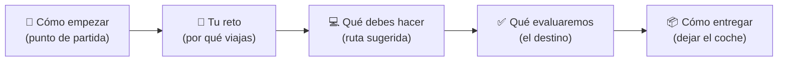
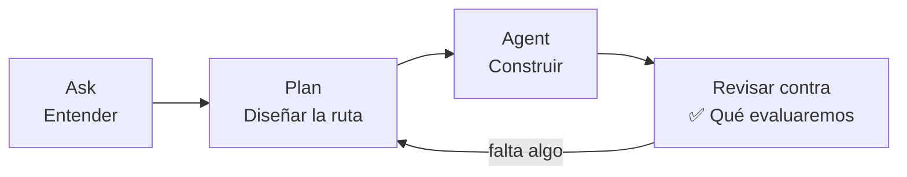
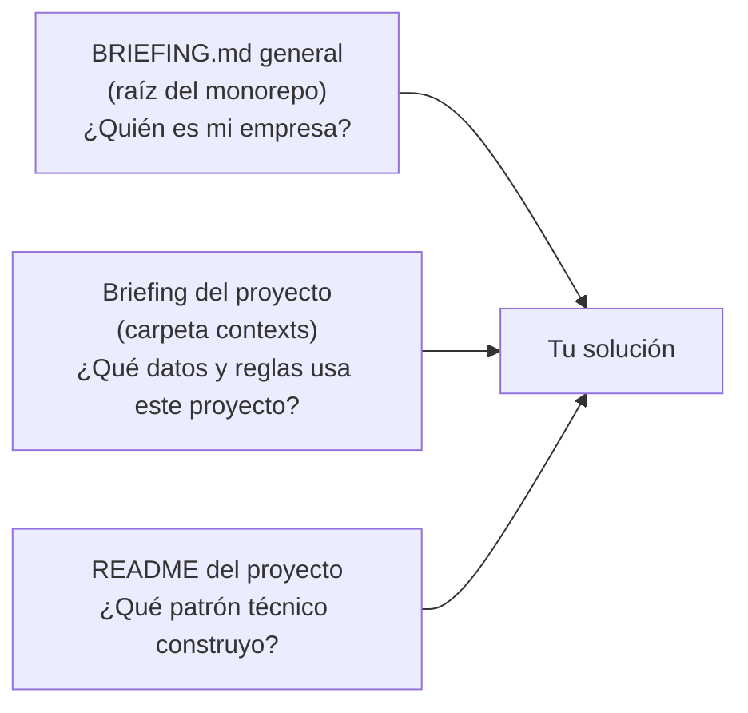

# Cómo están estructurados los proyectos

<!-- hide -->

_These instructions are also available in [English](https://github.com/4GeeksAcademy/ai-engineering-syllabus/blob/main/content/lessons/how-projects-are-structured/how-projects-are-structured.md)._

<!-- endhide -->

Abres tu primer proyecto y te encuentras con un README largo: un reto, una lista de pasos, otra lista de tareas con casillas, una lista de cosas que se van a evaluar y unas instrucciones de entrega. Es fácil sentir que todo pesa lo mismo y que tienes que entenderlo todo antes de escribir una sola línea. O lo contrario: copiar el README completo en el agente de código y esperar que salga algo.

Ninguna de las dos funciona. Cada sección del README tiene un **propósito distinto** y merece un **nivel de atención distinto**. Esta lección te enseña a leerlas así, para que pongas tu energía donde está el aprendizaje: **entender el problema y construir una solución**.

## Qué vas a lograr

- Reconocer las cinco secciones que tienen todos los proyectos y saber para qué sirve cada una.
- Distinguir lo que tienes que **pensar** (el reto y la evaluación) de lo que solo tienes que **seguir** (cómo empezar y cómo entregar).
- Usar cada sección en el momento correcto del trabajo con tu agente de código: **Ask → Plan → Agent**.
- Entender qué añaden los **proyectos de la compañía**: el monorepo, los briefings, los milestones y el ticket del tech lead.

## La idea central: un proyecto es un viaje

Piensa en cada proyecto como un viaje en coche. Hay un punto de partida, un destino, una ruta sugerida y un lugar donde dejas el coche al final. Pero lo más importante es saber **por qué** viajas y **adónde** quieres llegar.



En el README, **Tu reto** aparece antes que **Cómo empezar**, porque primero tienes que saber de qué va el proyecto. En la práctica las dos se leen casi a la vez: preparas el entorno mientras entiendes el problema.

## Las cinco secciones, una por una

### 🎯 Tu reto: entiende el problema y empieza desde aquí

Esta es la sección más importante del proyecto. Cuenta **qué problema existe, para quién y por qué importa**. A veces viene como una historia (un amigo artista necesita una web), a veces como un ticket o un brief de tu tech lead, y casi siempre incluye restricciones: cosas que *no* puedes hacer o reglas que tu solución tiene que respetar.

Muchos retos incluyen además bloques **📚 Conocimiento complementario**. Explican el concepto que necesitas para resolver el problema (una máquina de estados, qué es un ORM, el problema N+1…). No son lectura opcional: son la teoría mínima para que entiendas lo que vas a construir.

Cómo leerla:

- Léela **despacio y más de una vez**. Subraya los verbos ("debe", "no puede", "siempre", "nunca"): ahí están las reglas.
- Intenta explicar el problema con tus propias palabras en dos o tres frases. Si no puedes, todavía no lo entendiste.
- Anota lo que no entiendes. Esas dudas son las primeras preguntas para tu agente o tu mentor.

> 💡 Si solo vas a dedicar tiempo de calidad a una sección, que sea esta. Un agente de código puede escribir código por ti, pero no puede entender el problema por ti.

### 🌱 Cómo empezar: sigue los pasos

Aquí te dicen qué repositorio abrir, si tienes que hacer fork o usar una plantilla, si abrirlo en Codespaces, qué dependencias instalar y qué archivo leer primero.

Esta sección **no se interpreta, se sigue**. Está escrita para que arranques sin tener que tomar decisiones. Si un paso no funciona o no lo entiendes, no te quedes bloqueado buscando la manera "perfecta" de empezar: **pregunta** a tu mentor, a tus compañeros o a tu agente y sigue avanzando.

> ⚠️ Quedarse paralizado en "cómo empiezo" es una de las formas más comunes de perder un día entero. El inicio ya está resuelto para ti: úsalo.

### 💻 Qué debes hacer: una ruta, no la única

Es una lista de tareas, a menudo con casillas, nombres de archivos, endpoints o funciones concretas. Parece la parte más "real" del proyecto, pero tómala **con pinzas**.

Piensa en ella como la ruta que te propone Google Maps: es una buena referencia y suele ser el camino más directo, pero **no es el único camino posible**. Además, gran parte de estas tareas las va a ejecutar tu **agente de código**, no tú escribiendo línea por línea.

Cómo usarla:

- Úsala para entender **qué piezas** tendrá la solución y cómo se relacionan.
- Pásasela al agente como **contexto** durante la fase de planificación, no como una orden para ejecutar a ciegas.
- Si el agente propone otro camino que también llega al destino (ver la siguiente sección), está bien, siempre que **sepas explicar por qué** funciona.

### ✅ Qué evaluaremos: el destino

Esta lista es **el destino del viaje**. Es contra lo que se revisa tu entrega, así que es tu checklist personal antes de entregar.

Cómo usarla:

- Léela **al principio**, justo después del reto. Saber adónde vas cambia cómo planificas.
- Durante el trabajo, compara cada avance con esta lista: ¿esto me acerca a algún punto?
- Antes de entregar, revísala punto por punto y comprueba que tu proyecto **cumple** cada uno. No basta con "creo que sí": ábrelo, ejecútalo, compruébalo.

> 💡 Un buen ejercicio es pedirle al agente, en modo Ask, que revise tu proyecto contra esta lista y te diga qué falta. Pero la decisión final de si se cumple es tuya.

### 📦 Cómo entregar: sigue los pasos

Igual que **Cómo empezar**, esta sección son pasos que se siguen sin demasiado cuestionamiento: hacer commit y push, abrir un Pull Request, comprobar que `.env` no se sube, añadir una captura, entregar la URL en la plataforma…

Puedes consultar siempre que lo necesites, pero no conviertas la entrega en un problema nuevo. Es el punto de llegada.

### Dónde poner tu energía

| Sección | Qué es | Cómo tratarla |
| --- | --- | --- |
| 🎯 Tu reto | El problema | **Pensar a fondo** |
| 🌱 Cómo empezar | El punto de partida | Seguir los pasos |
| 💻 Qué debes hacer | Una ruta sugerida | Usar como referencia |
| ✅ Qué evaluaremos | El destino | **Contrastar con tu trabajo** |
| 📦 Cómo entregar | El punto de llegada | Seguir los pasos |

Cómo empezar y cómo entregar son el **inicio y el fin**. Lo que está en medio (entender el problema y construir la solución) es donde realmente aprendes.

## Trabajar el proyecto con tu agente: Ask → Plan → Agent

Durante el curso trabajas con un agente de código en tres fases. Cada sección del README encaja en una de ellas:



1. **Ask (entender).** Aquí trabajas con **🎯 Tu reto** y **✅ Qué evaluaremos**. Pregúntale al agente lo que no entiendes: conceptos, restricciones, términos nuevos. Todavía no se escribe código. El objetivo es que *tú* entiendas el problema.
2. **Plan (diseñar la ruta).** Ahora entra **💻 Qué debes hacer**. Pide al agente un plan para resolver el reto y cumplir la evaluación, usando la lista de tareas como referencia. Lee el plan, cuestiónalo y ajústalo. Si no entiendes un paso del plan, vuelve a Ask.
3. **Agent (construir).** Con el plan aprobado, deja que el agente implemente. Tu trabajo es revisar lo que hace, ejecutarlo y comprobar que tiene sentido.
4. **Revisar.** Compara el resultado con **✅ Qué evaluaremos**. Si falta algo, vuelve a planificar esa parte.

**🌱 Cómo empezar** ocurre antes de este ciclo y **📦 Cómo entregar**, después. No necesitan un plan: son los pasos de entrada y salida.

## Una forma práctica de leer cualquier proyecto

Cuando abras un proyecto nuevo, prueba este orden:

1. Lee **🎯 Tu reto** completo, incluidos los bloques de conocimiento complementario.
2. Lee **✅ Qué evaluaremos** para saber adónde tienes que llegar.
3. Sigue **🌱 Cómo empezar** hasta tener el entorno listo.
4. Echa un vistazo a **💻 Qué debes hacer** para hacerte una idea de las piezas.
5. Trabaja con tu agente en **Ask → Plan → Agent**.
6. Revisa tu trabajo contra **✅ Qué evaluaremos**.
7. Sigue **📦 Cómo entregar**.

## Los proyectos de la compañía

Todo lo anterior vale para **cualquier** proyecto del curso. Pero muchos de ellos son **proyectos de la compañía**, y eso añade una capa más: se construyen dentro de **tu empresa**. No tienes que adivinar cuáles son: el README de cada proyecto **siempre lo indica**. Cuando lo veas, ya sabes que tienes que trabajar sobre el monorepo de tu empresa.

### Una empresa, un monorepo, todo el curso

Al principio del curso eliges una empresa ficticia. A partir de ahí, todos los proyectos de la compañía se construyen sobre **un único repositorio**: tu copia del [monorepo de la empresa](https://github.com/4GeeksAcademy/ai-engineering-company-project-monorepo). Un monorepo es un repositorio que contiene varias partes de un mismo sistema (web, backoffice, APIs, agentes, pipelines de datos…) en un solo lugar.

### Un monorepo no es una aplicación: es un ecosistema

Este punto confunde mucho al principio. Un monorepo **no es una sola aplicación** con un `index.html` o un `main.py` en la raíz. Es un **ecosistema**: varias aplicaciones y piezas independientes que conviven en el mismo repositorio, cada una en su propia carpeta y con su propia responsabilidad.

La estructura de tu monorepo será parecida a esta (los nombres exactos pueden variar):

```text
mi-empresa-monorepo/
├── BRIEFING.md        ← el contexto de tu empresa
├── AGENTS.md          ← las reglas para tu agente de código
├── memory-bank/       ← la memoria del proyecto para los agentes
├── docs/              ← documentación técnica y de negocio
├── uis/               ← las interfaces de usuario
│   ├── web/           ← la web pública de la empresa
│   └── backoffice/    ← la herramienta interna del equipo
├── services/          ← las APIs y servicios de backend
├── data/              ← datos y pipelines de datos
├── scripts/           ← procesos independientes (cronjobs, utilidades)
└── packages/          ← código compartido entre las demás partes
```

Fíjate en lo que **no** hay en la raíz: ni un `index.html`, ni un `app.py`, ni un `styles.css`. La raíz es como el **recibidor de un edificio**: ahí está la información general (el `BRIEFING.md`, las reglas, la documentación) y desde ahí se llega a cada apartamento. Cada aplicación vive en su propia carpeta.

### ¿Usar un monorepo es una mala práctica?

No. Es una forma de organizar el código tan válida como otras, y la usan empresas muy grandes: Google, Meta, Microsoft o Uber guardan gran parte de su código en monorepos. Incluso hay herramientas pensadas específicamente para trabajar con ellos, como Nx o Turborepo.

La alternativa más común es el **polyrepo**: un repositorio distinto para cada aplicación o servicio. Ninguna de las dos opciones es "la correcta". Cada equipo elige según su tamaño, cómo se coordina y cómo despliega.

En este curso, el monorepo tiene además un **fin académico**: te permite ver todo el sistema de tu empresa en un solo lugar, entender cómo se conectan sus piezas y llevarlo al final del curso como un proyecto completo para tu portafolio. Pero que tenga un propósito académico no significa que sea algo artificial: es una solución que existe y se usa en el mundo real, y vas a encontrártela en tu trabajo.

### Qué significa trabajar siempre en el mismo monorepo

Esto significa que:

- **No creas un repositorio nuevo** por proyecto. Siempre trabajas sobre tu misma copia.
- Cada proyecto **construye sobre lo anterior**. Si un proyecto dice "ya deberías tener la autenticación", es porque un proyecto previo la creó en ese mismo monorepo.
- Al final del curso, todo ese trabajo forma **un sistema completo** que podrás enseñar en tu portafolio.

Lo verás en el reto con un aviso como este:

> 📌 Estás construyendo sobre **tu copia** del **monorepo** de la empresa seleccionada al inicio del curso — no en un repositorio nuevo.

### Los briefings: el contexto de tu empresa

Todos los estudiantes resuelven los **mismos retos técnicos**, pero cada uno con los **datos y nombres de su empresa**. Ese contexto vive en los **briefings**, y hay dos niveles:

**1. El briefing general de tu empresa (`BRIEFING.md` en la raíz del monorepo).** En el primer proyecto de la compañía, **Elige tu empresa**, lees los perfiles de las empresas disponibles, eliges una y copias su briefing general en la raíz de tu monorepo como `BRIEFING.md`, sustituyendo el archivo de ejemplo que trae la plantilla. Ese archivo describe tu empresa en conjunto: sector, departamentos, personajes, problemas y su hoja de ruta. Se queda ahí durante todo el curso y es la base de todo lo demás.

**2. El briefing de cada proyecto.** Además, cada proyecto de la compañía tiene **su propio briefing**, con el contexto específico de ese proyecto: los nombres exactos de entidades y campos, las reglas de negocio, los datos semilla, los valores esperados… Lo encontrarás al principio del README, en un aviso como este:

> **Antes de empezar**: lee tu **company-BRIEFING.md** antes de escribir código — define los nombres de campos, las categorías válidas y los valores semilla esperados para tu implementación.

Ese enlace te lleva a la carpeta [`contexts`](https://github.com/4GeeksAcademy/ai-engineering-syllabus/tree/main/content/contexts) del temario, donde cada proyecto tiene su carpeta con un briefing por empresa y por idioma (por ejemplo, `<tu-empresa>-BRIEFING.es.md`). Abre **solo el de tu empresa**.



Dicho de otra forma: el **README** describe el patrón técnico que todos construyen, el **briefing general** te dice quién es tu empresa y el **briefing del proyecto** pone los detalles concretos que tu solución tiene que respetar. Por eso los proyectos dicen cosas como "define la entidad equivalente a producto según tu briefing".

> ⚠️ Una solución genérica que ignore tu empresa no se acepta. Antes de planificar con el agente, dale como contexto **los dos briefings**: el general y el del proyecto.

### El ticket o el brief del tech lead

En los proyectos de la compañía, **🎯 Tu reto** suele venir escrito como en un equipo real: un **ticket** (por ejemplo, `Ticket #DEV-53`) o un **brief de tu tech lead**, con **criterios de aceptación**. Léelo como lo leería un ingeniero en su trabajo: ¿qué se pide?, ¿qué condiciones tiene que cumplir?, ¿qué decisiones ya están tomadas y cuáles me tocan a mí?

Los criterios de aceptación del ticket y la lista de **✅ Qué evaluaremos** van de la mano: los dos te describen el destino.

### Los milestones

Los **milestones** son los grandes hitos del proyecto de tu empresa: elegir la empresa, la web pública, el backend, el frontend, la base de conocimiento RAG, los flujos con agentes… Cada uno junta lo aprendido en los proyectos anteriores y lo convierte en una parte real del sistema de la empresa.

Entre milestone y milestone hay proyectos más pequeños (autenticación, telemetría, cronjobs, colas de mensajes…) que también viven en el mismo monorepo y preparan el terreno para el siguiente hito.

### Cómo cambian las secciones en un proyecto de la compañía

| Sección | Qué cambia |
| --- | --- |
| 🎯 Tu reto | Viene como ticket o brief, con criterios de aceptación y bloques de conocimiento complementario. Siempre se lee junto a tu `BRIEFING.md` general y el briefing del proyecto. |
| 🌱 Cómo empezar | Casi nunca creas un repositorio: abres tu monorepo, vas a la carpeta indicada (`uis/web/`, `services/`, `scripts/`…) y añades lo necesario. |
| 💻 Qué debes hacer | Indica dónde vive cada pieza dentro del monorepo. Los nombres concretos los pone el briefing del proyecto. |
| ✅ Qué evaluaremos | Incluye comprobar que tu solución respeta tu empresa (nombres, reglas, datos semilla). |
| 📦 Cómo entregar | Normalmente: trabajar en una rama, subir los cambios a **tu** copia, abrir un Pull Request y entregar la URL en la plataforma. |

## Checklist antes de empezar cualquier proyecto

- [ ] Leí **🎯 Tu reto** completo y puedo explicar el problema con mis palabras.
- [ ] Leí los bloques de **📚 Conocimiento complementario**.
- [ ] Leí **✅ Qué evaluaremos** y sé cuál es el destino.
- [ ] Seguí **🌱 Cómo empezar** y mi entorno funciona (o ya pregunté lo que no funcionaba).
- [ ] Si es un proyecto de la compañía: estoy en **mi** monorepo, tengo a mano mi `BRIEFING.md` general y leí el briefing de este proyecto para mi empresa.
- [ ] Empecé con el agente en **Ask**, no directamente en **Agent**.

## Conclusión

Los proyectos no son listas de tareas para tachar: son **problemas para resolver**. La estructura del README está pensada para quitarte de encima lo que no es importante (cómo empezar y cómo entregar ya están resueltos) y para que dediques tu atención a lo que sí lo es: **entender el reto, saber cuál es el destino y construir una solución con tu agente** que puedas explicar.

Empieza siguiendo los pasos. Entiende el problema. Planifica la ruta. Construye. Comprueba que llegaste. Entrega.
