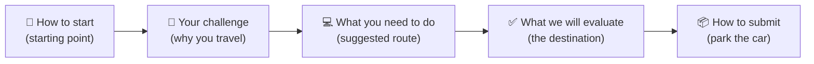
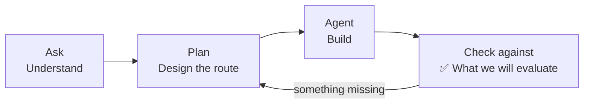
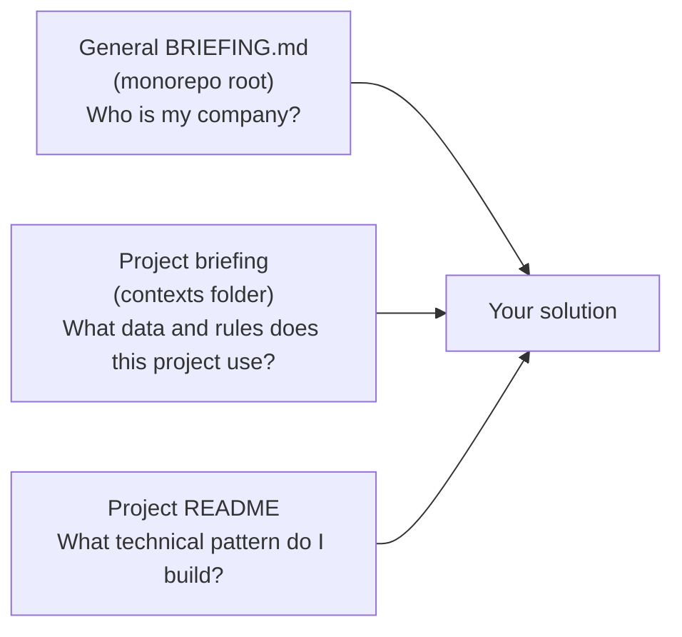

# How projects are structured

<!-- hide -->

_Estas instrucciones también están disponibles en [español](https://github.com/4GeeksAcademy/ai-engineering-syllabus/blob/main/content/lessons/how-projects-are-structured/how-projects-are-structured.es.md)._

<!-- endhide -->

You open your first project and find a long README: a challenge, a list of steps, another list of tasks with checkboxes, a list of things that will be evaluated, and submission instructions. It is easy to feel that everything weighs the same and that you have to understand all of it before writing a single line. Or the opposite: paste the whole README into the coding agent and hope something comes out.

Neither works. Each README section has a **different purpose** and deserves a **different level of attention**. This lesson teaches you to read them that way, so you put your energy where the learning is: **understanding the problem and building a solution**.

## What you will achieve

- Recognize the five sections every project has and know what each one is for.
- Tell apart what you need to **think through** (the challenge and the evaluation) from what you just need to **follow** (how to start and how to submit).
- Use each section at the right moment of your work with your coding agent: **Ask → Plan → Agent**.
- Understand what **company projects** add: the monorepo, briefings, milestones, and the tech lead's ticket.

## The core idea: a project is a trip

Think of every project as a road trip. There is a starting point, a destination, a suggested route, and a place where you park the car at the end. But the most important part is knowing **why** you are traveling and **where** you want to arrive.



In the README, **Your challenge** appears before **How to start**, because first you need to know what the project is about. In practice you read both almost at the same time: you set up the environment while you understand the problem.

## The five sections, one by one

### 🎯 Your challenge: understand the problem and start from here

This is the most important section of the project. It tells you **what problem exists, for whom, and why it matters**. Sometimes it comes as a story (an artist friend needs a website), sometimes as a ticket or a brief from your tech lead, and it almost always includes constraints: things you *cannot* do, or rules your solution must respect.

Many challenges also include **📚 Complementary Knowledge** blocks. They explain the concept you need to solve the problem (a state machine, what an ORM is, the N+1 problem…). They are not optional reading: they are the minimum theory you need to understand what you are going to build.

How to read it:

- Read it **slowly and more than once**. Underline the verbs ("must", "cannot", "always", "never"): that is where the rules are.
- Try to explain the problem in your own words in two or three sentences. If you cannot, you have not understood it yet.
- Write down what you do not understand. Those doubts are your first questions for your agent or your mentor.

> 💡 If you only spend quality time on one section, make it this one. A coding agent can write code for you, but it cannot understand the problem for you.

### 🌱 How to start: follow the steps

This section tells you which repository to open, whether to fork it or use a template, whether to open it in Codespaces, which dependencies to install, and which file to read first.

You **do not interpret this section, you follow it**. It is written so you can get going without having to make decisions. If a step fails or you do not understand it, do not get stuck looking for the "perfect" way to start: **ask** your mentor, your classmates, or your agent, and keep moving.

> ⚠️ Getting stuck on "how do I start" is one of the most common ways to lose an entire day. The start is already solved for you: use it.

### 💻 What you need to do: a route, not the only one

This is a task list, often with checkboxes, file names, endpoints, or specific functions. It looks like the most "real" part of the project, but take it **with a grain of salt**.

Think of it as the route Google Maps suggests: a good reference and usually the most direct path, but **not the only possible one**. Also, most of these tasks will be carried out by your **coding agent**, not by you typing line by line.

How to use it:

- Use it to understand **which pieces** the solution will have and how they relate to each other.
- Give it to the agent as **context** during the planning phase, not as an order to execute blindly.
- If the agent proposes a different path that also reaches the destination (see the next section), that is fine, as long as **you can explain why** it works.

### ✅ What we will evaluate: the destination

This list is **the destination of the trip**. It is what your submission is reviewed against, so it is your personal checklist before you submit.

How to use it:

- Read it **at the beginning**, right after the challenge. Knowing where you are going changes how you plan.
- While you work, compare every step forward with this list: does this get me closer to any item?
- Before submitting, go through it item by item and verify your project **meets** each one. "I think so" is not enough: open it, run it, check it.

> 💡 A good exercise is to ask the agent, in Ask mode, to review your project against this list and tell you what is missing. But the final call on whether each item is met is yours.

### 📦 How to submit: follow the steps

Like **How to start**, this section is a set of steps you follow without much questioning: commit and push, open a Pull Request, make sure `.env` is not uploaded, add a screenshot, submit the URL on the platform…

You can always ask when you need to, but do not turn submission into a new problem. It is the finish line.

### Where to put your energy

| Section | What it is | How to treat it |
| --- | --- | --- |
| 🎯 Your challenge | The problem | **Think it through** |
| 🌱 How to start | The starting point | Follow the steps |
| 💻 What you need to do | A suggested route | Use it as a reference |
| ✅ What we will evaluate | The destination | **Check your work against it** |
| 📦 How to submit | The finish line | Follow the steps |

How to start and how to submit are the **beginning and the end**. What sits in between (understanding the problem and building the solution) is where you actually learn.

## Working the project with your agent: Ask → Plan → Agent

During the course you work with a coding agent in three phases. Each README section fits into one of them:



1. **Ask (understand).** Here you work with **🎯 Your challenge** and **✅ What we will evaluate**. Ask the agent about whatever you do not understand: concepts, constraints, new terms. No code is written yet. The goal is for *you* to understand the problem.
2. **Plan (design the route).** Now **💻 What you need to do** comes in. Ask the agent for a plan that solves the challenge and meets the evaluation, using the task list as a reference. Read the plan, question it, and adjust it. If you do not understand a step in the plan, go back to Ask.
3. **Agent (build).** With the plan approved, let the agent implement it. Your job is to review what it does, run it, and check that it makes sense.
4. **Check.** Compare the result with **✅ What we will evaluate**. If something is missing, plan that part again.

**🌱 How to start** happens before this cycle and **📦 How to submit** happens after it. They do not need a plan: they are the entry and exit steps.

## A practical way to read any project

When you open a new project, try this order:

1. Read **🎯 Your challenge** in full, including the complementary knowledge blocks.
2. Read **✅ What we will evaluate** so you know where you need to arrive.
3. Follow **🌱 How to start** until your environment is ready.
4. Skim **💻 What you need to do** to get an idea of the pieces.
5. Work with your agent through **Ask → Plan → Agent**.
6. Check your work against **✅ What we will evaluate**.
7. Follow **📦 How to submit**.

## Company projects

Everything above applies to **any** project in the course. But many of them are **company projects**, and that adds one more layer: they are built inside **your company**. You do not have to guess which ones they are: each project's README **always says so**. When you see it, you know you have to work on your company monorepo.

### One company, one monorepo, the whole course

At the beginning of the course you choose a fictional company. From then on, every company project is built on **a single repository**: your copy of the [company monorepo](https://github.com/4GeeksAcademy/ai-engineering-company-project-monorepo). A monorepo is a repository that holds several parts of the same system (website, backoffice, APIs, agents, data pipelines…) in one place.

### A monorepo is not an application: it is an ecosystem

This point confuses a lot of people at first. A monorepo is **not a single application** with an `index.html` or a `main.py` at the root. It is an **ecosystem**: several independent applications and pieces living in the same repository, each one in its own folder and with its own responsibility.

Your monorepo will look something like this (exact names may vary):

```text
my-company-monorepo/
├── BRIEFING.md        ← your company's context
├── AGENTS.md          ← the rules for your coding agent
├── memory-bank/       ← the project memory for agents
├── docs/              ← technical and business documentation
├── uis/               ← the user interfaces
│   ├── web/           ← the company's public website
│   └── backoffice/    ← the team's internal tool
├── services/          ← backend APIs and services
├── data/              ← data and data pipelines
├── scripts/           ← standalone processes (cronjobs, utilities)
└── packages/          ← code shared across the other parts
```

Notice what is **not** at the root: no `index.html`, no `app.py`, no `styles.css`. The root is like the **lobby of a building**: it holds the general information (`BRIEFING.md`, the rules, the documentation), and from there you reach each apartment. Each application lives in its own folder.

### Is using a monorepo a bad practice?

No. It is as valid a way to organize code as any other, and very large companies use it: Google, Meta, Microsoft, and Uber keep much of their code in monorepos. There are even tools built specifically for working with them, such as Nx or Turborepo.

The most common alternative is the **polyrepo**: a separate repository for each application or service. Neither option is "the right one". Each team chooses based on its size, how it coordinates, and how it deploys.

In this course, the monorepo also has an **academic purpose**: it lets you see your company's whole system in one place, understand how its pieces connect, and take it to the end of the course as a complete project for your portfolio. But having an academic purpose does not make it artificial: it is a real-world solution that is used in industry, and you will run into it at work.

### What it means to always work in the same monorepo

This means that:

- You **do not create a new repository** for each project. You always work on the same copy.
- Each project **builds on the previous ones**. If a project says "you should already have authentication", it is because an earlier project created it in that same monorepo.
- By the end of the course, all that work forms **one complete system** you can show in your portfolio.

You will see it in the challenge with a notice like this one:

> 📌 You are building on **your own fork** of the company's **monorepo** selected at the beginning of the course — not on a new repository.

### Briefings: your company's context

Every student solves the **same technical challenges**, but each one with **their own company's data and names**. That context lives in the **briefings**, and there are two levels:

**1. Your company's general briefing (`BRIEFING.md` at the root of the monorepo).** In the first company project, **Choose Your Company**, you read the available company profiles, pick one, and copy its general briefing to the root of your monorepo as `BRIEFING.md`, replacing the placeholder file that comes with the template. That file describes your company as a whole: industry, departments, characters, problems, and roadmap. It stays there for the whole course and is the foundation for everything else.

**2. Each project's briefing.** On top of that, every company project has **its own briefing**, with the context specific to that project: exact entity and field names, business rules, seed data, expected values… You will find it at the top of the README, in a notice like this one:

> **Before you start**: read your **company-BRIEFING.md** before writing code — it defines the field names, valid categories, and expected seed values for your implementation.

That link takes you to the syllabus [`contexts`](https://github.com/4GeeksAcademy/ai-engineering-syllabus/tree/main/content/contexts) folder, where each project has its own folder with one briefing per company and per language (for example, `<your-company>-BRIEFING.en.md`). Open **only your company's**.



In other words: the **README** describes the technical pattern everyone builds, the **general briefing** tells you who your company is, and the **project briefing** supplies the specific details your solution must respect. That is why projects say things like "define the product-equivalent entity from your briefing".

> ⚠️ A generic solution that ignores your company will not be accepted. Before planning with the agent, give it **both briefings** as context: the general one and the project one.

### The tech lead's ticket or brief

In company projects, **🎯 Your challenge** is usually written the way it would be in a real team: a **ticket** (for example, `Ticket #DEV-53`) or a **brief from your tech lead**, with **acceptance criteria**. Read it the way an engineer would at work: what is being asked? What conditions must it meet? Which decisions are already made, and which ones are mine?

The ticket's acceptance criteria and the **✅ What we will evaluate** list go hand in hand: both describe the destination.

### Milestones

**Milestones** are the big checkpoints of your company project: choosing the company, the public website, the backend, the frontend, the RAG knowledge base, agentic workflows… Each one brings together what you learned in the previous projects and turns it into a real part of the company's system.

Between milestones there are smaller projects (authentication, telemetry, cronjobs, message queues…) that also live in the same monorepo and prepare the ground for the next milestone.

### How the sections change in a company project

| Section | What changes |
| --- | --- |
| 🎯 Your challenge | It comes as a ticket or brief, with acceptance criteria and complementary knowledge blocks. Always read it together with your general `BRIEFING.md` and the project briefing. |
| 🌱 How to start | You almost never create a repository: you open your monorepo, go to the indicated folder (`uis/web/`, `services/`, `scripts/`…), and add what is needed. |
| 💻 What you need to do | It shows where each piece lives inside the monorepo. The project briefing supplies the specific names. |
| ✅ What we will evaluate | It includes checking that your solution respects your company (names, rules, seed data). |
| 📦 How to submit | Usually: work on a branch, push the changes to **your** copy, open a Pull Request, and submit the URL on the platform. |

## Checklist before starting any project

- [ ] I read **🎯 Your challenge** in full and can explain the problem in my own words.
- [ ] I read the **📚 Complementary Knowledge** blocks.
- [ ] I read **✅ What we will evaluate** and know what the destination is.
- [ ] I followed **🌱 How to start** and my environment works (or I already asked about what did not).
- [ ] If it is a company project: I am in **my** monorepo, have my general `BRIEFING.md` at hand, and read this project's briefing for my company.
- [ ] I started with the agent in **Ask**, not directly in **Agent**.

## Conclusion

Projects are not task lists to tick off: they are **problems to solve**. The README structure is designed to take the unimportant work off your plate (how to start and how to submit are already solved) so you can focus on what matters: **understanding the challenge, knowing the destination, and building a solution with your agent** that you can explain.

Start by following the steps. Understand the problem. Plan the route. Build. Check that you arrived. Submit.
