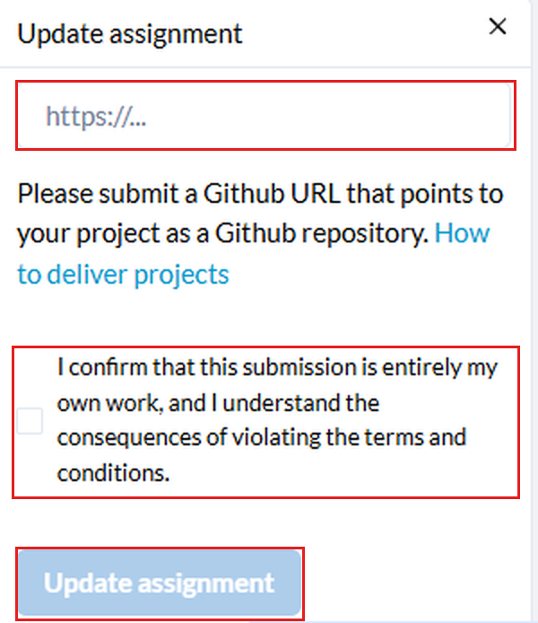

# Cómo entregar tu proyecto

<!-- hide -->

_These instructions are also available in [English](https://github.com/4GeeksAcademy/ai-engineering-syllabus/blob/main/content/lessons/how-to-deliver-your-project/how-to-deliver-your-project.md)._

<!-- endhide -->

Terminar un proyecto es solo la mitad del camino: para que cuente, tienes que entregarlo. Esta lección te explica cómo hacerlo, qué pasa después y qué responsabilidad implica.

> **Nota sobre el idioma:** la ventana de entrega aparece en las capturas en inglés. En tu pantalla puede verse en el idioma de tu programa, pero los campos y botones son los mismos.

## Qué vas a lograr

- Entregar un proyecto paso a paso.
- Reconocer los proyectos que no se entregan, solo se marcan como hechos.
- Saber quién revisa tu entrega, dónde ves el feedback y qué hacer si te la rechazan.
- Entender qué significa la confirmación que te pide la ventana de entrega.

## Primero, las instrucciones del proyecto

Cada proyecto explica al final cómo debes entregarlo. **Sigue siempre esas instrucciones.**

La forma más común de entrega es una **URL de un repositorio de GitHub**, pero algunos proyectos piden otra cosa, como un archivo o una imagen. Lo que mande el proyecto es lo que cuenta. En esta lección usamos el repositorio de GitHub como ejemplo.

## Cómo entregar paso a paso

1. Lee las instrucciones de entrega al final del proyecto y reúne lo que piden (en este ejemplo, la URL de tu repositorio).
2. Pulsa el botón del **avión de papel**, en la esquina inferior derecha.
3. Se abrirá la ventana **Update assignment**.
4. Pega tu URL en el campo de texto.
5. Marca la casilla de confirmación.
6. Pulsa **Update assignment** para enviar.

El botón **Update assignment** se activa cuando has pegado la URL y marcado la casilla. Antes de enviar, revisa que la URL esté completa y que se abra bien: una URL incorrecta puede retrasar tu feedback. Si tienes dudas, la propia ventana incluye el enlace **How to deliver projects**.

## Proyectos que no se entregan

Algunos proyectos no requieren entrega. Los reconocerás porque, al abrir la ventana del avión de papel, no puedes entregar nada: solo puedes **marcar el proyecto como hecho**. En ese caso, márcalo al terminar y listo.

## Después de entregar

- **Quién revisa:** tu entrega la revisan los mentores o el staff, según la etapa en la que estés.
- **Dónde ves el feedback:** en la misma plataforma, dentro del proyecto entregado.
- **Si te la rechazan:** no pasa nada, es parte del proceso. Lee el feedback, corrige lo necesario y vuelve a entregar.

Recuerda que el certificado del curso se obtiene cuando **todos tus proyectos obligatorios están aprobados**, así que vale la pena revisar el feedback y actuar sobre él.

## Tu responsabilidad al entregar

La ventana de entrega te pide confirmar que el trabajo es completamente tuyo y que entiendes las consecuencias de violar los términos y condiciones.

Esa confirmación es importante: lo que entregas representa lo que sabes y lo que aprendiste. Si tienes dudas sobre qué tipo de ayuda puedes usar en un proyecto, pregunta a tu Program Manager antes de entregar.

## Lista de verificación antes de entregar

- Leí las instrucciones de entrega al final del proyecto.
- Mi proyecto cumple lo que se pedía.
- Mi URL está completa y se abre correctamente.
- Si entrego un repositorio, es **público**, para que quien lo revise pueda verlo.
- Pulsé el botón del avión de papel y completé los campos.
- Marqué la casilla de confirmación y envié la entrega.

## Para cerrar

Recuerda tus tres prioridades: dale peso a los proyectos, usa a Rigobot para empezar y entrega siguiendo siempre las instrucciones de cada proyecto.

Si quieres repasar las anteriores: [Qué priorizar en tu programa](https://learn.4geeks.com/es/lesson/how-to-work-your-4geeks-program-es) y [El proyecto y Rigobot, tu apoyo para empezar](https://learn.4geeks.com/es/lesson/project-page-and-rigobot-es).
