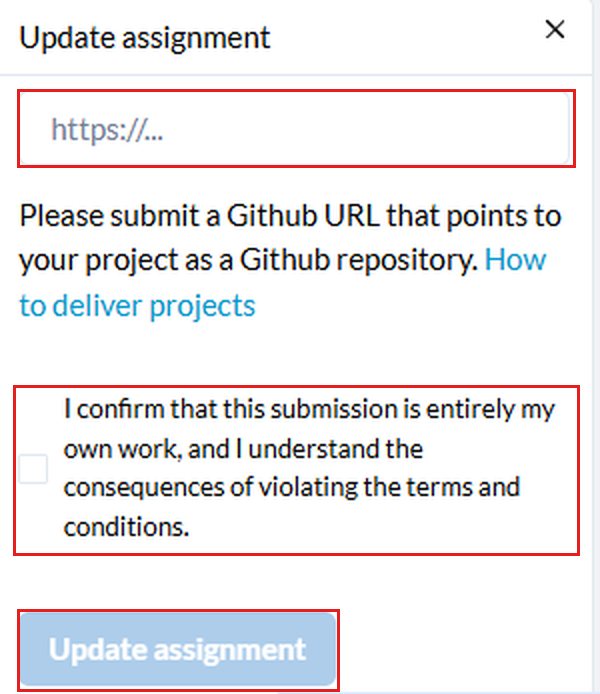

# How to deliver your project

<!-- hide -->

_Estas instrucciones también están disponibles en [español](https://github.com/4GeeksAcademy/ai-engineering-syllabus/blob/main/content/lessons/how-to-deliver-your-project/how-to-deliver-your-project.es.md)._

<!-- endhide -->

Finishing a project is only half the way: for it to count, you have to submit it. This lesson explains how to do it, what happens next, and what responsibility it involves.

> **A note on language:** the submission window appears in English in the screenshots. On your screen it may appear in your program's language, but the fields and buttons are the same.

## What you will achieve

- Submit a project step by step.
- Recognize projects that aren't submitted, only marked as done.
- Know who reviews your submission, where you see the feedback, and what to do if it's rejected.
- Understand what the confirmation in the submission window means.

## First, the project's instructions

Every project explains at the end how you must submit it. **Always follow those instructions.**

The most common way to submit is a **GitHub repository URL**, but some projects ask for something else, such as a file or an image. Whatever the project says is what counts. In this lesson we use a GitHub repository as the example.

## How to submit, step by step

1. Read the submission instructions at the end of the project and gather what they ask for (in this example, your repository URL).
2. Click the **paper plane** button in the bottom-right corner.
3. The **Update assignment** window will open.
4. Paste your URL into the text field.
5. Check the confirmation box.
6. Click **Update assignment** to submit.

The **Update assignment** button becomes active once you've pasted the URL and checked the box. Before submitting, make sure the URL is complete and opens correctly: a wrong URL can delay your feedback. If you have questions, the window itself includes the **How to deliver projects** link.

## Projects that aren't submitted

Some projects don't require a submission. You'll recognize them because, when you open the paper plane window, you can't submit anything: you can only **mark the project as done**. In that case, mark it when you finish and you're all set.

## After you submit

- **Who reviews it:** your submission is reviewed by mentors or staff, depending on the stage you're in.
- **Where you see the feedback:** on the platform itself, inside the submitted project.
- **If it's rejected:** that's fine, it's part of the process. Read the feedback, fix what's needed, and submit again.

Remember that you earn the course certificate when **all your required projects are approved**, so it's worth reading the feedback and acting on it.

## Your responsibility when submitting

The submission window asks you to confirm that the work is entirely your own and that you understand the consequences of violating the terms and conditions.

That confirmation matters: what you submit represents what you know and what you learned. If you're unsure what kind of help you can use on a project, ask your Program Manager before submitting.

## Checklist before submitting

- I read the submission instructions at the end of the project.
- My project meets what was asked.
- My URL is complete and opens correctly.
- If I'm submitting a repository, it is **public**, so whoever reviews it can see it.
- I clicked the paper plane button and filled in the fields.
- I checked the confirmation box and sent the submission.

## Wrapping up

Remember your three priorities: give projects the weight they deserve, use Rigobot to get started, and always submit following each project's instructions.

If you want to review the previous lessons: [What to prioritize in your program](https://learn.4geeks.com/lesson/how-to-work-your-4geeks-program) and [The project and Rigobot, your help to get started](https://learn.4geeks.com/lesson/project-page-and-rigobot).
