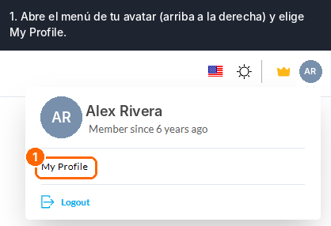
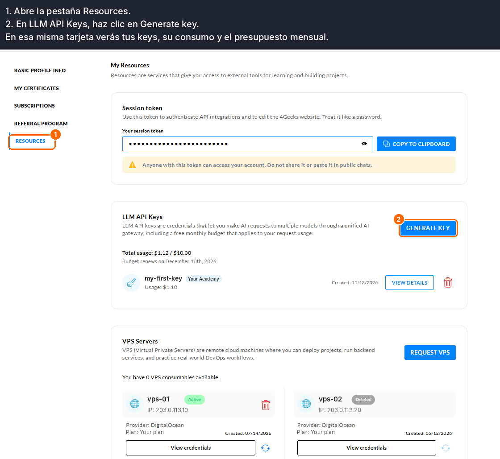
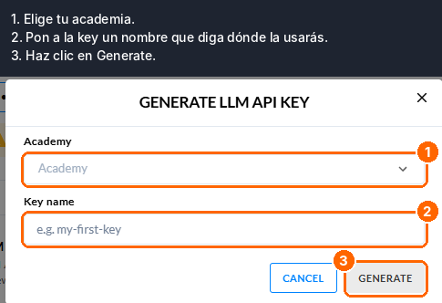
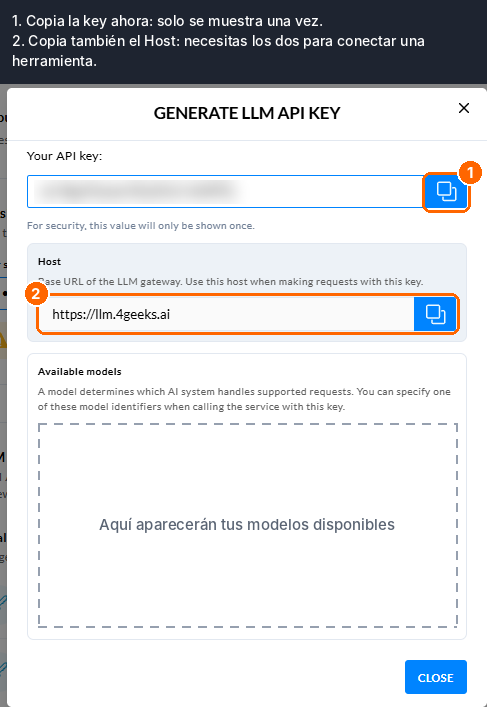
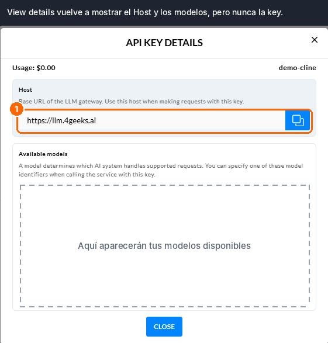

# 🔑 Cómo obtener una API key de LLM en 4Geeks

<!-- hide -->

_These instructions are also available in [English](https://github.com/4GeeksAcademy/ai-engineering-syllabus/blob/main/content/lessons/how-to-get-llm-api-key-4geeks/how-to-get-llm-api-key-4geeks.md)._

<!-- endhide -->

Quieres conectar un agente de código a un modelo de IA y la pantalla de configuración te pide una API key y una URL base. Abres tu perfil de 4Geeks y encuentras un session token, un botón "Generate key" y una lista de servidores. Copias el primer valor largo que ves, lo pegas en la herramienta y recibes un error de autenticación. O peor: generas la key correcta, cierras la ventana y descubres que no se volverá a mostrar.

4Geeks te da una API key de LLM con un presupuesto mensual para que uses varios modelos de IA a través de un único gateway. En esta lección verás dónde está esa key, cómo generarla, qué dos valores tienes que copiar, cómo comprobar que funciona y cómo mantenerla segura. Te llevará unos cinco minutos y solo lo haces una vez por herramienta.

## Encuentra la sección Resources

1. Inicia sesión en tu cuenta de 4Geeks.
2. Abre el menú de tu avatar, en la esquina superior derecha, y elige **My Profile**.



3. En el menú de la izquierda de tu perfil, abre **Resources**.



## Qué encontrarás en Resources

La página reúne los servicios que 4Geeks te da para aprender y construir proyectos. No los confundas: cada uno tiene un uso distinto.

| Recurso | Para qué sirve | ¿Lo usas para conectar una herramienta de IA? |
| --- | --- | --- |
| Session token | Te autentica en la API y la web de 4Geeks. Quien lo tenga puede entrar en tu cuenta | **No.** Trátalo como una contraseña y nunca lo pegues en otra herramienta |
| LLM API keys | Hacen peticiones a modelos de IA a través del gateway de 4Geeks, con un presupuesto mensual | **Sí.** Esta es la key que necesitas |
| VPS servers | Máquinas remotas en la nube para desplegar proyectos y practicar DevOps | No. Si tu plan los incluye, los encontrarás aquí |

El error más común es usar el session token como API key. No funciona con los modelos de IA y, además, estarías compartiendo el acceso a toda tu cuenta.

## Genera tu API key de LLM

1. En la tarjeta **LLM API Keys**, haz clic en **Generate key**.
2. En **Academy**, elige la academia de tu curso.
3. En **Key name**, escribe un nombre que te diga dónde vas a usar la key, por ejemplo `cline-desktop` o `mi-portatil-cli`.
4. Haz clic en **Generate**.



El nombre descriptivo importa más adelante: si una key se filtra, sabrás qué herramienta la usaba y podrás borrar solo esa.

## Copia la key y el Host

Cuando generas la key, la ventana muestra tres cosas:

- **Your API key**: el valor secreto. Empieza por `sk-`.
- **Host**: la URL base del gateway de 4Geeks, `https://llm.4geeks.ai`.
- **Available models**: los identificadores de los modelos que puedes usar con esta key.



Copia la key **antes de cerrar la ventana**. Por seguridad, solo se muestra una vez. Guárdala en un gestor de contraseñas o en un archivo `.env` local de tu proyecto (lo verás en la última sección). Copia también el Host: cualquier herramienta que conectes te pedirá los dos valores.

Si cierras la ventana sin copiar la key, no pasa nada: borra esa key y genera una nueva.

## Comprueba tu key

### View details

Tu nueva key aparece en la lista de la tarjeta **LLM API Keys**, con su consumo y su fecha de creación. **View details** vuelve a mostrar el Host y los modelos disponibles, pero nunca la key.



### Pruébala desde la terminal (opcional)

Puedes comprobar que la key funciona pidiéndole al gateway la lista de modelos. Primero guarda la key en una variable de entorno para no tener que pegarla en cada comando.

En macOS o Linux (bash o zsh):

```bash
# Sustituye el valor por tu propia key
export GEEKS_LLM_API_KEY="sk-tu-key"

curl https://llm.4geeks.ai/v1/models \
  -H "Authorization: Bearer $GEEKS_LLM_API_KEY"
```

En Windows (PowerShell):

```powershell
# Sustituye el valor por tu propia key
$env:GEEKS_LLM_API_KEY = "sk-tu-key"

curl.exe https://llm.4geeks.ai/v1/models `
  -H "Authorization: Bearer $env:GEEKS_LLM_API_KEY"
```

Cómo leer el resultado:

- **Un JSON con una lista `data`**: la key funciona. Cada elemento tiene un `id` con el identificador de un modelo, los mismos que viste en **Available models**.
- **Error `401`**: la key está mal copiada, incompleta o fue borrada. Cópiala de nuevo o genera otra.
- **El comando se queda colgado o no resuelve el host**: revisa tu conexión y que la URL sea exactamente `https://llm.4geeks.ai/v1/models`.

## Vigila tu presupuesto

La tarjeta **LLM API Keys** muestra:

- **Total usage**: lo que llevas gastado frente a tu presupuesto mensual, sumando todas tus keys.
- **Budget renews on**: la fecha en que el presupuesto vuelve a empezar.
- **Usage** de cada key: cuánto ha consumido cada herramienta.

El presupuesto es compartido por todas tus keys. Si una herramienta gasta mucho más que las demás, su key te dirá cuál es. Cuando llegas al límite, el gateway puede rechazar las peticiones hasta que el presupuesto se renueve.

## Mantén tu key segura

Una API key es una credencial: quien la tenga gasta tu presupuesto. Sigue estas reglas:

- **Nunca la subas a Git.** Guárdala en un archivo `.env` y añade ese archivo a `.gitignore`:

```bash
# .env
GEEKS_LLM_API_KEY=sk-tu-key
```

```bash
# .gitignore
.env
```

- **No la pegues** en chats, foros, capturas de pantalla ni pantallas compartidas.
- **Una key por herramienta.** Si una se filtra, borras solo esa y las demás siguen funcionando.
- **Si una key se filtra**, bórrala con el icono de la papelera que aparece junto a ella en la lista y genera una nueva. La key antigua deja de funcionar.

## Checklist de tu API key de LLM

- [ ] Llegas a **My Profile > Resources** sin ayuda.
- [ ] Puedes explicar la diferencia entre el session token y una API key de LLM.
- [ ] Generaste una key con un nombre que dice dónde la vas a usar.
- [ ] Guardaste la key y el Host (`https://llm.4geeks.ai`) en un lugar seguro.
- [ ] La petición a `/v1/models` devuelve un JSON con una lista `data` (si hiciste la prueba).
- [ ] La key no está en ningún archivo que Git rastree.
- [ ] Sabes dónde consultar tu consumo total y la fecha de renovación de tu presupuesto.

## Conclusión

Conectar cualquier herramienta de IA a los modelos de 4Geeks se reduce a dos valores: la API key, que demuestra quién eres, y el Host, que indica a dónde enviar las peticiones. Genera una key por herramienta con un nombre claro, cópiala mientras está en pantalla, mantenla fuera de Git y vigila tu consumo en la misma tarjeta. Con ese hábito, revocar o sustituir una key te lleva segundos y nunca rompe el resto de tu configuración.
