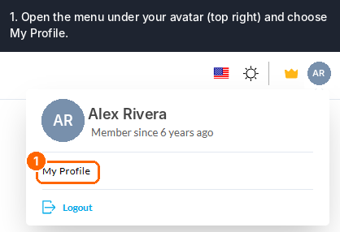
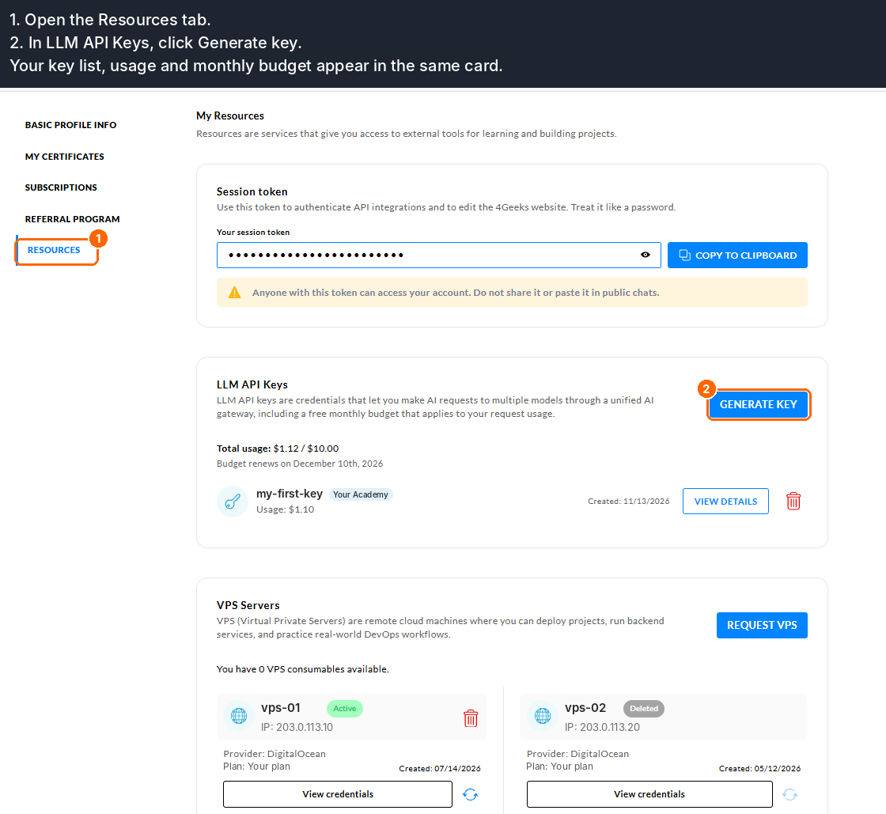
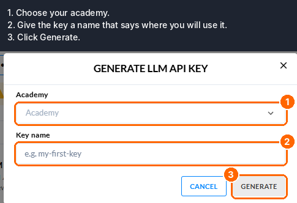
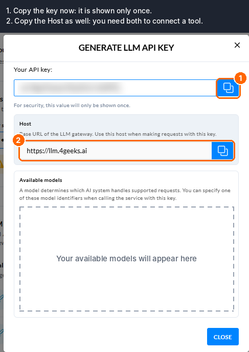
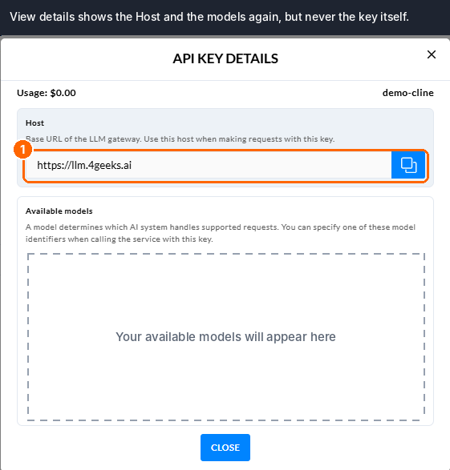

# 🔑 How to get an LLM API key in 4Geeks

<!-- hide -->

_Estas instrucciones también están disponibles en [español](https://github.com/4GeeksAcademy/ai-engineering-syllabus/blob/main/content/lessons/how-to-get-llm-api-key-4geeks/how-to-get-llm-api-key-4geeks.es.md)._

<!-- endhide -->

You want to connect a coding agent to an AI model, and the setup screen asks for an API key and a base URL. You open your 4Geeks profile and find a session token, a "Generate key" button and a list of servers. You copy the first long value you see, paste it into the tool, and get an authentication error. Or worse: you generate the right key, close the window, and discover it will never be shown again.

4Geeks gives you an LLM API key with a monthly budget so you can use several AI models through a single gateway. This lesson shows you where that key lives, how to generate it, which two values you need to copy, how to check that it works and how to keep it safe. It takes about five minutes, and you only do it once per tool.

## Find the Resources section

1. Sign in to your 4Geeks account.
2. Open the menu under your avatar, in the top-right corner, and choose **My Profile**.



3. In the left menu of your profile, open **Resources**.



## What you will find in Resources

The page groups the services 4Geeks gives you for learning and building projects. Do not mix them up: each one has a different use.

| Resource | What it is for | Use it to connect an AI tool? |
| --- | --- | --- |
| Session token | Authenticates you in the 4Geeks API and website. Anyone who has it can access your account | **No.** Treat it like a password and never paste it into another tool |
| LLM API keys | Make requests to AI models through the 4Geeks gateway, with a monthly budget | **Yes.** This is the key you need |
| VPS servers | Remote cloud machines to deploy projects and practice DevOps | No. If your plan includes them, you will find them here |

The most common mistake is using the session token as an API key. It will not work with AI models, and you would be sharing access to your whole account.

## Generate your LLM API key

1. In the **LLM API Keys** card, click **Generate key**.
2. In **Academy**, choose the academy of your course.
3. In **Key name**, write a name that tells you where you will use the key, for example `cline-desktop` or `my-laptop-cli`.
4. Click **Generate**.



A descriptive name matters later: if a key leaks, you will know which tool used it and you can delete only that one.

## Copy the key and the Host

After you generate the key, the window shows three things:

- **Your API key**: the secret value. It starts with `sk-`.
- **Host**: the base URL of the 4Geeks gateway, `https://llm.4geeks.ai`.
- **Available models**: the model identifiers you can use with this key.



Copy the key **before you close the window**. For security, it is shown only once. Store it in a password manager or in a local `.env` file of your project (see the last section). Copy the Host too: any tool you connect will ask for both values.

If you close the window without copying the key, nothing is lost: delete that key and generate a new one.

## Check your key

### View details

Your new key appears in the list of the **LLM API Keys** card, with its usage and creation date. **View details** shows the Host and the available models again, but never the key itself.



### Test it from the terminal (optional)

You can check that the key works by asking the gateway for the list of models. First, save the key in an environment variable so you do not have to paste it into every command.

On macOS or Linux (bash or zsh):

```bash
# Replace the value with your own key
export GEEKS_LLM_API_KEY="sk-your-key"

curl https://llm.4geeks.ai/v1/models \
  -H "Authorization: Bearer $GEEKS_LLM_API_KEY"
```

On Windows (PowerShell):

```powershell
# Replace the value with your own key
$env:GEEKS_LLM_API_KEY = "sk-your-key"

curl.exe https://llm.4geeks.ai/v1/models `
  -H "Authorization: Bearer $env:GEEKS_LLM_API_KEY"
```

How to read the result:

- **JSON with a `data` list**: the key works. Each element has an `id` with a model identifier, the same ones you saw in **Available models**.
- **Error `401`**: the key is wrong, incomplete or was deleted. Copy it again or generate a new one.
- **The command hangs or cannot resolve the host**: check your connection and that the URL is exactly `https://llm.4geeks.ai/v1/models`.

## Watch your budget

The **LLM API Keys** card shows:

- **Total usage**: what you have spent against your monthly budget, adding up all your keys.
- **Budget renews on**: the date the budget starts again.
- **Usage** of each key: how much each tool has consumed.

The budget is shared by all your keys. If one tool spends much more than the others, its key tells you which one. When you reach the limit, the gateway can reject requests until the budget renews.

## Keep your key safe

An API key is a credential: whoever has it spends your budget. Follow these rules:

- **Never commit it.** Save it in a `.env` file and add that file to `.gitignore`:

```bash
# .env
GEEKS_LLM_API_KEY=sk-your-key
```

```bash
# .gitignore
.env
```

- **Do not paste it** into chats, forums, screenshots or shared screens.
- **One key per tool.** If one leaks, you delete only that one and the rest keep working.
- **If a key leaks**, delete it with the trash icon next to it in the list and generate a new one. The old key stops working.

## LLM API key checklist

- [ ] You can open **My Profile > Resources** without help.
- [ ] You can explain the difference between the session token and an LLM API key.
- [ ] You generated a key with a name that says where you will use it.
- [ ] You saved the key and the Host (`https://llm.4geeks.ai`) somewhere safe.
- [ ] The request to `/v1/models` returns a JSON with a `data` list (if you ran the test).
- [ ] The key is not in any file tracked by Git.
- [ ] You know where to check your total usage and the renewal date of your budget.

## Conclusion

Connecting any AI tool to the 4Geeks models comes down to two values: the API key, which proves who you are, and the Host, which says where to send the requests. Generate one key per tool with a clear name, copy it while it is on screen, keep it out of Git and watch your usage in the same card. With that habit, revoking or replacing a key takes seconds and never breaks the rest of your setup.
