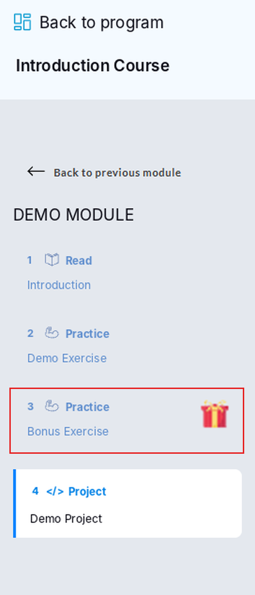

# Qué priorizar en tu programa

<!-- hide -->

_These instructions are also available in [English](https://github.com/4GeeksAcademy/ai-engineering-syllabus/blob/main/content/lessons/how-to-work-your-4geeks-program/how-to-work-your-4geeks-program.md)._

<!-- endhide -->

Tu programa tiene muchos pasos, y no todos pesan lo mismo. Esta lección te ayuda a decidir dónde poner tu energía para avanzar con orden y sin agobiarte.

## Qué vas a lograr

- Reconocer los tres tipos de paso y para qué sirve cada uno.
- Distinguir lo obligatorio de lo opcional.
- Saber cómo se obtienen el certificado del curso y los microcertificados.

## Los tres tipos de paso

Cada módulo está formado por pasos de tres tipos:

- **Read:** lecturas para conocer un tema.
- **Practice:** contenido interactivo para empezar a aplicar lo leído. Puede combinar teoría dividida en secciones cortas para que sea más fácil de digerir, actividades y videos.
- **Project:** el momento real de practicar. Es donde pones a prueba lo que aprendiste.

## Los proyectos son lo que más cuenta

Los proyectos son la parte con mayor peso de tu programa, por una razón concreta: **el certificado del curso se obtiene aprobando todos los proyectos obligatorios**. No hay notas ni evaluaciones adicionales.

Por eso, cuando decidas en qué invertir tu tiempo, los proyectos son la prioridad.

## Las lecturas y las prácticas son una puerta de entrada

Las lecturas y las prácticas te introducen en un tema, pero una sola lectura no te convierte en experto, y no tiene por qué hacerlo. Son el punto de partida.

Será en el proyecto donde descubras qué conceptos entendiste bien y cuáles necesitas reforzar. Cuando eso pase, no lo tomes como un fallo: es la señal para volver a una lectura o a una práctica con una pregunta concreta, y aprovecharla mucho mejor.

Las lecturas y las prácticas **no se entregan**: se trabajan para aprender y prepararte para los proyectos, que son lo que sí se entrega.

## Pasos opcionales: el icono de regalo

Algunos pasos muestran un **icono de regalo** a la derecha. Son opcionales: puedes dejarlos para el final, cuando ya hayas completado lo obligatorio.

## Certificado y microcertificados

- **Certificado del curso:** se obtiene al aprobar el 100 % de los proyectos obligatorios del curso.
- **Microcertificados:** cada curso se divide en certificaciones, los cuadros que ves en el panel de tu programa. Cuando una de ellas llega al 100 % de avance, recibes su microcertificado automáticamente.

Los pasos opcionales **no cuentan** para ese 100 %. Puedes completarlos cuando quieras sin que te frenen.

## Un orden que funciona

1. Entra al módulo y avanza por las lecturas y prácticas para entender el tema.
2. Pasa al proyecto y trabájalo con calma.
3. Si el proyecto te muestra vacíos, vuelve a la lectura o práctica que corresponda.
4. Entrega el proyecto.
5. Al final, dedica tiempo a los pasos con icono de regalo.

## Siguientes pasos

- [El proyecto y Rigobot, tu apoyo para empezar](https://learn.4geeks.com/es/lesson/project-page-and-rigobot-es): conoce la pantalla de un proyecto y cómo arrancar.
- [Cómo entregar tu proyecto](https://learn.4geeks.com/es/lesson/how-to-deliver-your-project-es): cómo enviarlo para que cuente.
