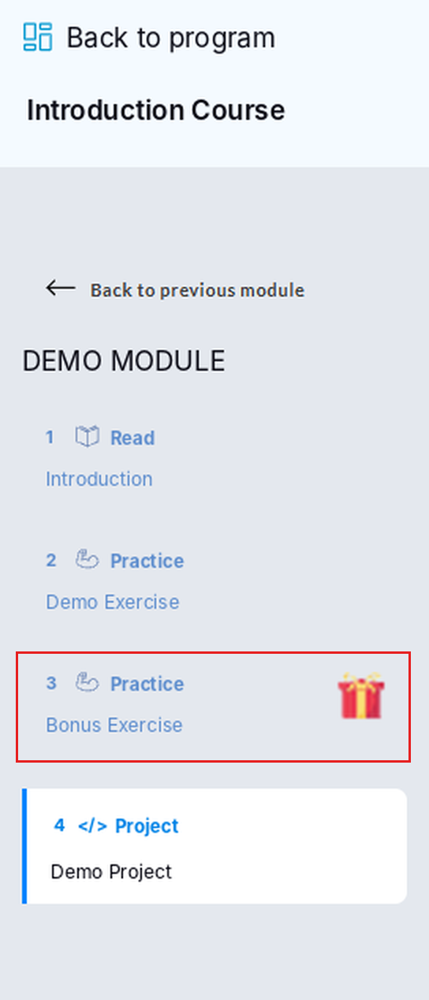

# What to prioritize in your program

<!-- hide -->

_Estas instrucciones también están disponibles en [español](https://github.com/4GeeksAcademy/ai-engineering-syllabus/blob/main/content/lessons/how-to-work-your-4geeks-program/how-to-work-your-4geeks-program.es.md)._

<!-- endhide -->

Your program has many steps, and they don't all carry the same weight. This lesson helps you decide where to put your energy so you can move forward in an orderly way without feeling overwhelmed.

## What you will achieve

- Recognize the three types of steps and what each one is for.
- Tell what is required apart from what is optional.
- Know how you earn the course certificate and the micro-certificates.

## The three types of steps

Every module is made of three types of steps:

- **Read:** readings that introduce a topic.
- **Practice:** interactive content to start applying what you read. It can combine theory split into short sections so it's easier to digest, activities, and videos.
- **Project:** the real moment of practice. This is where you put what you learned to the test.

## Projects are what counts the most

Projects carry the most weight in your program, for a concrete reason: **you earn the course certificate by getting all the required projects approved**. There are no grades or additional evaluations.

So when you decide where to invest your time, projects come first.

## Readings and practices are a way in

Readings and practices introduce you to a topic, but a single reading won't make you an expert, and it doesn't have to. They are the starting point.

The project is where you'll find out which concepts you understood well and which ones you need to reinforce. When that happens, don't take it as a failure: it's the signal to go back to a reading or a practice with a specific question, and get much more out of it.

Readings and practices **are not submitted**: you work through them to learn and to prepare for the projects, which are what you do submit.

## Optional steps: the gift icon

Some steps show a **gift icon** on the right. They are optional: you can leave them for the end, once you've completed everything that is required.

## Certificate and micro-certificates

- **Course certificate:** you earn it when 100% of the course's required projects are approved.
- **Micro-certificates:** each course is divided into certifications, the boxes you see on your program dashboard. When one of them reaches 100% progress, you receive its micro-certificate automatically.

Optional steps **do not count** toward that 100%. You can complete them whenever you want without them holding you back.

## An order that works

1. Enter the module and go through the readings and practices to understand the topic.
2. Move on to the project and work on it calmly.
3. If the project reveals gaps, go back to the matching reading or practice.
4. Submit the project.
5. At the end, spend time on the steps with the gift icon.

## Next steps

- [The project and Rigobot, your help to get started](https://learn.4geeks.com/lesson/project-page-and-rigobot): get to know a project's page and how to get started.
- [How to deliver your project](https://learn.4geeks.com/lesson/how-to-deliver-your-project): how to submit it so it counts.
