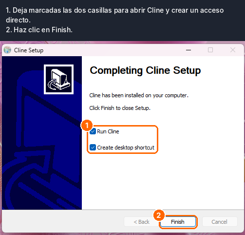
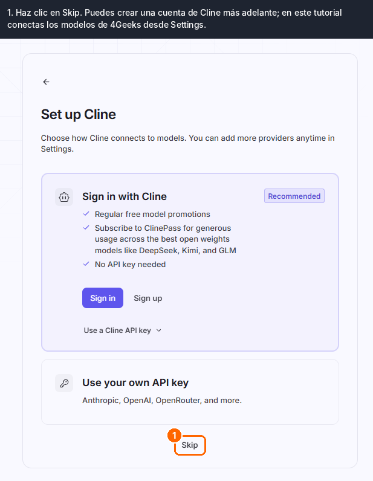
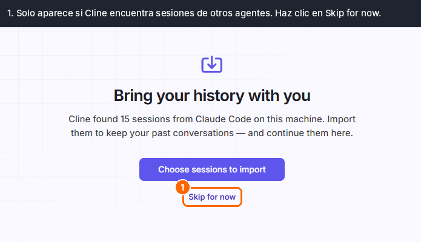
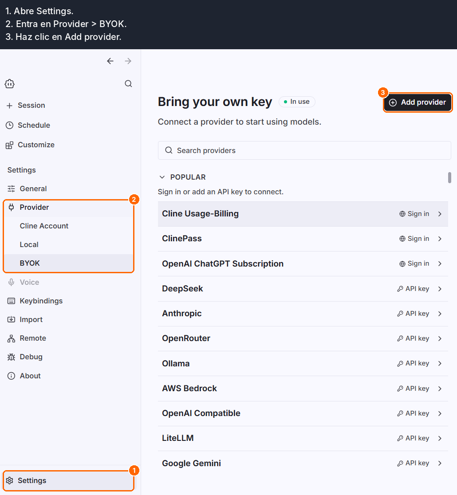
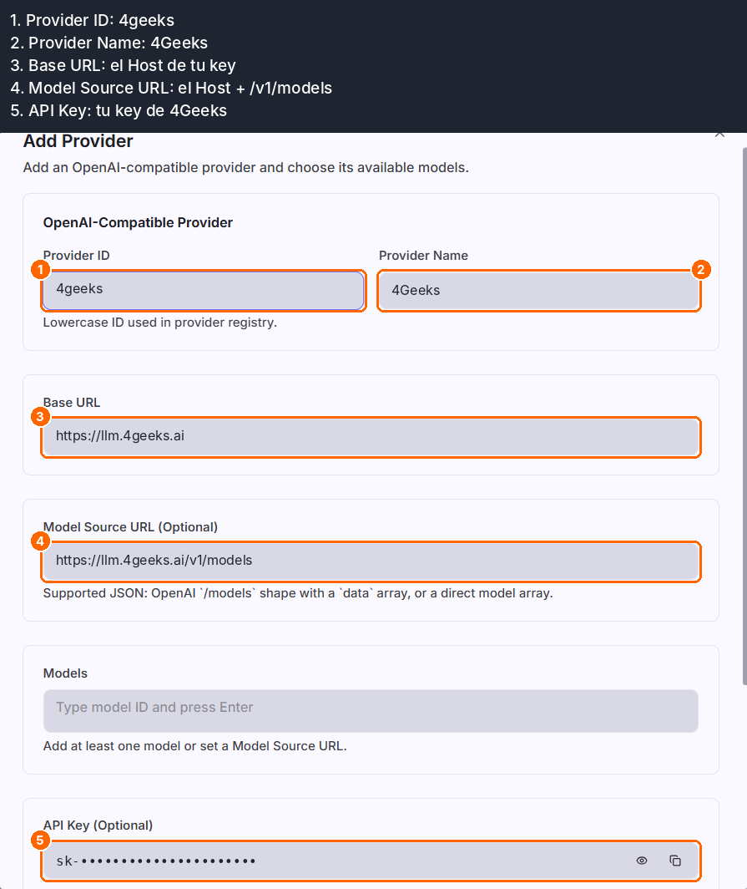
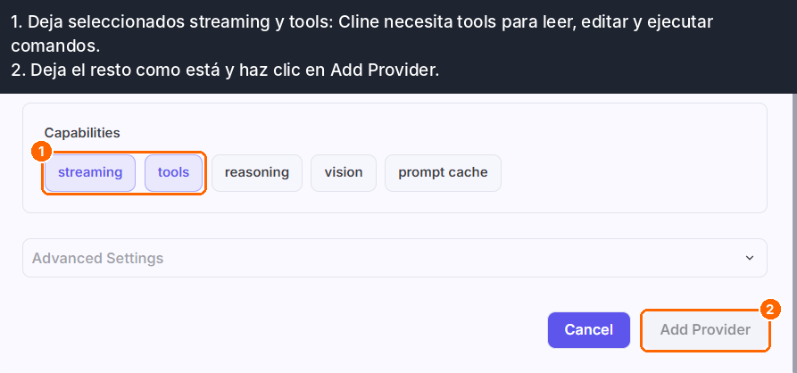
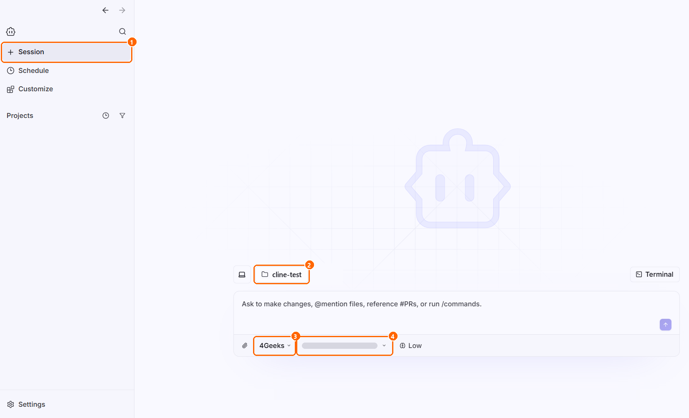

# 🛠️ Instala Cline Desktop y conéctalo a los modelos de 4Geeks

<!-- hide -->

_These instructions are also available in [English](https://github.com/4GeeksAcademy/ai-engineering-syllabus/blob/main/content/lessons/install-cline-desktop-4geeks-models/install-cline-desktop-4geeks-models.md)._

<!-- endhide -->

Instalas un agente de código, lo abres y la primera pantalla te ofrece una cuenta, una suscripción, créditos y una lista de treinta proveedores. Haces clic en "Recommended", inicias sesión y acabas en un panel de facturación con saldo cero. Veinte minutos después todavía no has escrito ni un prompt y no tienes claro qué modelo vas a pagar.

Esta lección toma el camino corto. Instalas Cline Desktop, te saltas la configuración de la cuenta y conectas Cline a los modelos que 4Geeks ya te da, usando tu API key de LLM como proveedor personalizado. Al final tendrás una primera conversación con Cline para comprobar que todo funciona. Calcula unos 15 minutos.

## Antes de empezar

Necesitas:

- **Una computadora con Windows o macOS.** Cline Desktop está disponible para los dos. No hay versión de escritorio para Linux: en Linux, usa la extensión de Cline para VS Code o la CLI de Cline y conéctalas con los mismos valores que verás aquí.
- **Unos 520 MB libres en disco.**
- **Tu API key de LLM de 4Geeks y su Host** (`https://llm.4geeks.ai`). Si todavía no los tienes, sigue primero [Cómo obtener una API key de LLM en 4Geeks](https://learn.4geeks.com/es/lesson/how-to-get-llm-api-key-4geeks-es).

Cline Desktop es una app joven y cambia a menudo. Si un botón tiene un nombre un poco distinto en tu versión, busca el equivalente más cercano: el orden de los pasos se mantiene.

## Descarga Cline Desktop

1. Entra en [cline.bot/desktop](https://cline.bot/desktop).
2. Descarga el instalador de tu sistema operativo.

Descárgalo solo desde esa página. Si tu navegador o tu sistema operativo te avisan sobre el archivo, comprueba que viene de `cline.bot` antes de continuar.

## Instala en Windows

1. Ejecuta el instalador que descargaste.
2. En la pantalla **Welcome to Cline Setup**, haz clic en **Next**.
3. En **Choose Install Location**, deja la carpeta por defecto (`C:\Users\<tu-usuario>\AppData\Local\Cline`) y haz clic en **Next**. Como se instala dentro de tu carpeta de usuario, normalmente no pide permisos de administrador.
4. Espera mientras se extraen los archivos. Tarda alrededor de un minuto.
5. En la última pantalla, deja marcadas **Run Cline** y **Create desktop shortcut** y haz clic en **Finish**.



## Instala en macOS

1. Abre el archivo `.dmg` que descargaste.
2. Sigue las instrucciones de la ventana que se abre. Normalmente arrastras el icono de Cline a la carpeta **Aplicaciones**.
3. Abre Cline desde **Aplicaciones** o desde Launchpad.

La app de macOS busca actualizaciones por su cuenta. Cuando hay una versión nueva lista, te pide reiniciar.

## Sáltate la configuración inicial

La primera vez que abres Cline, aparece un breve flujo de bienvenida.

1. En la pantalla de bienvenida, haz clic en **Get started**.
2. En **Set up Cline**, haz clic en **Skip**, abajo del todo.



Esa pantalla ofrece otros dos caminos: **Sign in with Cline**, que crea una cuenta de Cline con sus propios modelos gratuitos y planes de pago, y **Use your own API key**, para proveedores de una lista. Puedes crear una cuenta de Cline más adelante si quieres probarlos. En este curso usas los modelos de 4Geeks, y la forma más limpia de añadirlos es desde **Settings**, donde puedes crear un proveedor con tu propio nombre.

3. Si Cline encuentra sesiones de otros agentes en tu computadora (por ejemplo, de Claude Code), te ofrece importarlas. Haz clic en **Skip for now**. Puedes importarlas más tarde desde **Settings > Import**.



## Conecta los modelos de 4Geeks

### Abre los ajustes de BYOK

1. Haz clic en **Settings**, abajo en la barra lateral izquierda.
2. En el menú de ajustes, abre **Provider > BYOK** (Bring Your Own Key, "trae tu propia key").
3. Haz clic en **Add provider**.



No uses para esto los proveedores de la lista **Popular**: apuntan a otros servicios. Necesitas un proveedor personalizado que apunte al gateway de 4Geeks.

### Rellena el formulario del proveedor

El formulario **Add Provider** crea un proveedor compatible con OpenAI. Rellénalo con estos valores:

| Campo | Valor | Por qué |
| --- | --- | --- |
| Provider ID | `4geeks` | Identificador interno. Tiene que ir en minúsculas |
| Provider Name | `4Geeks` | El nombre que verás en el selector de modelos |
| Base URL | `https://llm.4geeks.ai` | El Host de tu key. Sin `/v1` al final |
| Model Source URL | `https://llm.4geeks.ai/v1/models` | El endpoint donde Cline lee la lista de modelos que puede usar tu key |
| Models | Déjalo vacío | Cline carga los modelos desde la Model Source URL |
| API Key | Tu key de 4Geeks (`sk-...`) | Autentica tus peticiones y las descuenta de tu presupuesto |



Dos detalles causan la mayoría de los errores:

- La **Base URL** es el Host tal cual, `https://llm.4geeks.ai`. La **Model Source URL** es ese mismo Host más `/v1/models`.
- Pega la key sin espacios delante ni detrás.

### Elige las capacidades y guarda

Al final del formulario, la sección **Capabilities** le dice a Cline qué pueden hacer los modelos del proveedor:

| Capacidad | Qué hacer | Por qué |
| --- | --- | --- |
| streaming | Déjala seleccionada | Cline muestra la respuesta mientras el modelo la escribe |
| tools | Déjala seleccionada | Cline necesita llamar a herramientas para leer archivos, editarlos y ejecutar comandos. Sin ella, el agente no puede actuar |
| reasoning, vision, prompt cache | Déjalas sin seleccionar | No todos los modelos del gateway las admiten. Activarlas para un modelo que no las tiene puede provocar errores |

Deja **Advanced Settings** como está y haz clic en **Add Provider**. Si el botón sigue desactivado, falta un campo obligatorio: revisa Provider ID, Provider Name, Base URL y la Model Source URL.



**4Geeks** aparece ahora en tu lista de proveedores.

### Comprueba los modelos

Abre el proveedor **4Geeks**. Su lista de modelos debería mostrar los mismos identificadores que viste en **Available models** al generar tu key en 4Geeks. Marca como favoritos (icono de estrella) los que vayas a usar, para encontrarlos más rápido en el selector de modelos.

Si la lista está vacía, ve a la sección de problemas frecuentes antes de seguir.

## Lanza tu primera sesión

Prueba la configuración con una conversación corta. No hace falta que Cline cree ni edite archivos: solo quieres comprobar que el modelo te responde.

Antes de empezar, crea una carpeta vacía, por ejemplo `cline-test`. Así Cline trabaja en un espacio donde no hay nada importante.

1. En Cline, haz clic en **Session** para empezar una sesión nueva.
2. Encima del cuadro de texto, haz clic en el botón de la carpeta y elige `cline-test` como espacio de trabajo.
3. Debajo del cuadro de texto, elige **4Geeks** en el selector de proveedor.
4. A su lado, elige uno de sus modelos en el selector de modelos.



5. Escribe un saludo y envíalo:

```text
Hola, preséntate en una frase y dime en qué me puedes ayudar.
```

Cómo interpretar el resultado:

- **Cline te responde en el chat**: Cline, el proveedor 4Geeks y tu key funcionan.
- **Aparece un error en lugar de una respuesta**: busca el mensaje en la sección de problemas frecuentes.

Un saludo como este apenas consume presupuesto, así que es normal que no veas cambios en el consumo de tu key. Aun así, acostúmbrate a revisar de vez en cuando **Total usage** en **My Profile > Resources** de 4Geeks, sobre todo cuando empieces a usar Cline en tus proyectos.

## Problemas frecuentes

| Síntoma | Causa probable | Qué hacer |
| --- | --- | --- |
| La lista de modelos de 4Geeks está vacía | Model Source URL o key incorrectas | Comprueba que la Model Source URL termina en `/v1/models` y vuelve a pegar la key. Como alternativa, escribe en **Models** un identificador de modelo de **View details** y pulsa Enter |
| Error `401` o "unauthorized" | Key incompleta, borrada o equivocada | Copia la key de nuevo. Si la perdiste, bórrala en 4Geeks y genera otra |
| Error `404` o "not found" | Base URL con una ruta de más | Deja la Base URL exactamente como `https://llm.4geeks.ai` |
| Peticiones que funcionaban empiezan a fallar | Presupuesto agotado | Revisa **Total usage** y la fecha de renovación en **My Profile > Resources** |
| Usaste el session token | No es una API key de LLM | Genera una API key de LLM y sustituye el valor |
| Cline responde pero nunca lee ni edita archivos | La capacidad **tools** está desactivada | Edita el proveedor 4Geeks y selecciona **tools** |

## Checklist de configuración de Cline Desktop

- [ ] Cline Desktop se abre desde el acceso directo o desde **Aplicaciones**.
- [ ] Te saltaste la configuración de la cuenta y no tuviste que comprar créditos ni una suscripción.
- [ ] **4Geeks** aparece en **Settings > Provider > BYOK** con la Base URL `https://llm.4geeks.ai`.
- [ ] El proveedor 4Geeks tiene seleccionadas las capacidades **streaming** y **tools**.
- [ ] El proveedor 4Geeks muestra los mismos modelos que **Available models** en tu key.
- [ ] Cline respondió a tu primer mensaje en una sesión con el proveedor 4Geeks.
- [ ] Sabes dónde revisar el consumo de tu key en 4Geeks y lo revisas de vez en cuando.
- [ ] Tu key solo está en los ajustes de Cline, no en ningún archivo de tu proyecto.

## Conclusión

Conectar un agente a un modelo siempre necesita las mismas tres cosas: a dónde enviar las peticiones (la Base URL), qué modelos existen (la Model Source URL) y quién las paga (la API key). Cline Desktop te deja configurarlas una sola vez como proveedor propio, sin cuentas ni suscripciones de por medio. A partir de ahora, cada sesión empieza eligiendo una carpeta, 4Geeks y un modelo.

Ver también: [Por qué 4Geeks empieza con Cline](https://learn.4geeks.com/es/lesson/why-4geeks-starts-with-cline-es).
