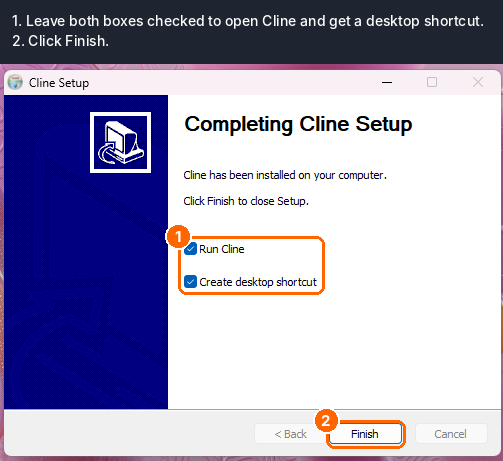
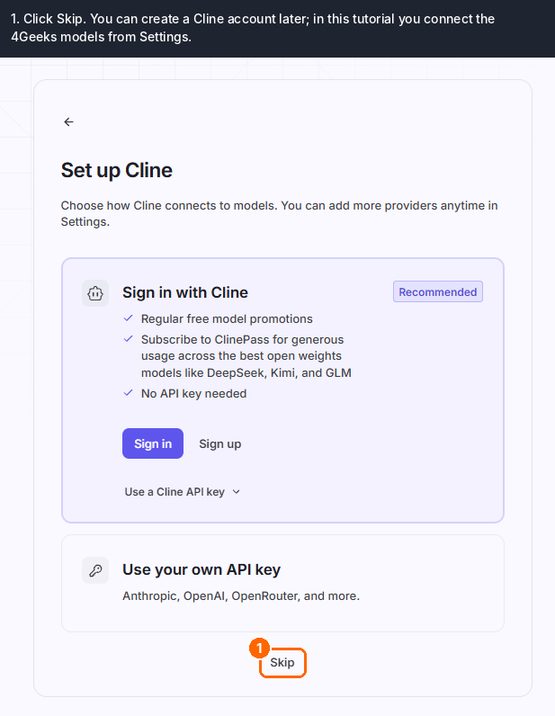
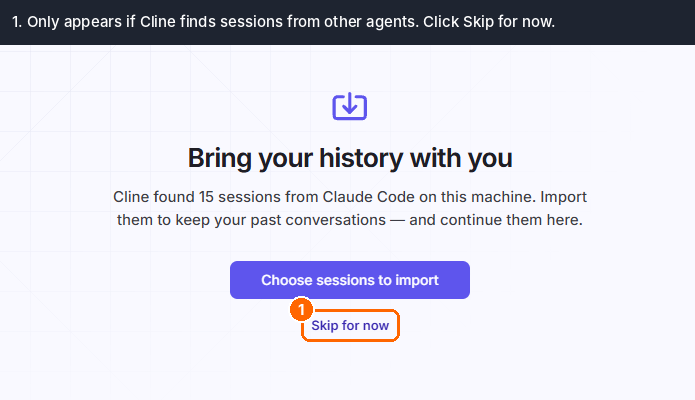
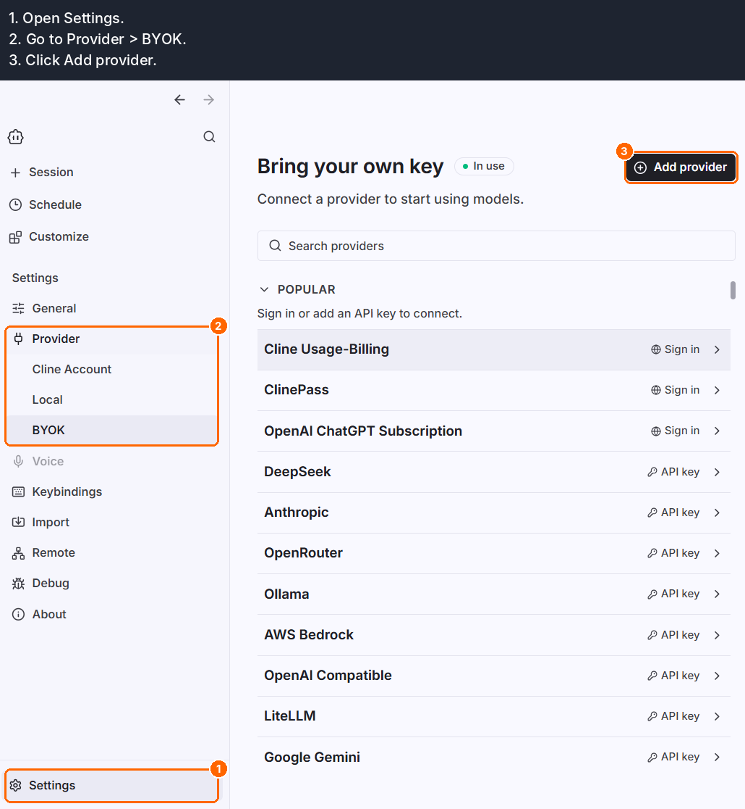
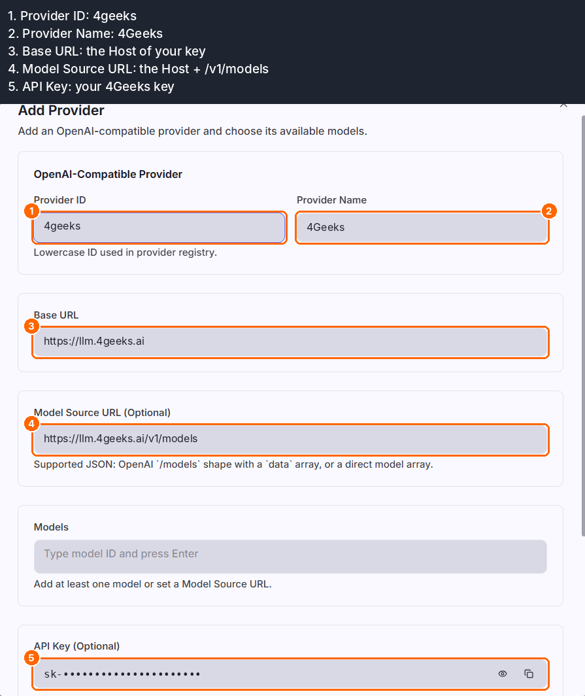
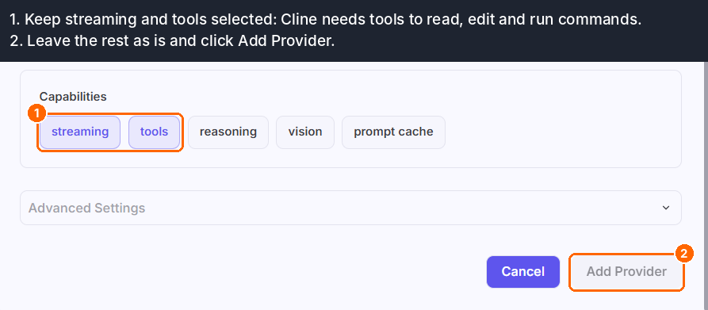
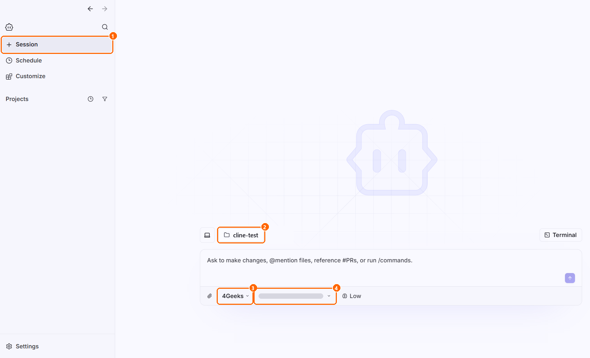

# 🛠️ Install Cline Desktop and connect it to the 4Geeks models

<!-- hide -->

_Estas instrucciones también están disponibles en [español](https://github.com/4GeeksAcademy/ai-engineering-syllabus/blob/main/content/lessons/install-cline-desktop-4geeks-models/install-cline-desktop-4geeks-models.es.md)._

<!-- endhide -->

You install a coding agent, open it, and the first screen offers you an account, a subscription, credits and a list of thirty providers. You click "Recommended", sign in, and end up on a billing dashboard with a balance of zero. Twenty minutes later you still have not written a single prompt, and you are not sure which model you are going to pay for.

This lesson takes the short path. You install Cline Desktop, skip the account setup, and connect Cline to the models that 4Geeks already gives you, using your LLM API key as a custom provider. At the end you will have a first conversation with Cline to check that everything works. Plan about 15 minutes.

## Before you start

You need:

- **A computer with Windows or macOS.** Cline Desktop is available for both. There is no Linux version of the desktop app: on Linux, use the Cline extension for VS Code or the Cline CLI, and connect them with the same values you will see here.
- **About 520 MB of free disk space.**
- **Your 4Geeks LLM API key and its Host** (`https://llm.4geeks.ai`). If you do not have them yet, follow [How to get an LLM API key in 4Geeks](https://learn.4geeks.com/lesson/how-to-get-llm-api-key-4geeks) first.

Cline Desktop is a young app and changes often. If a button has a slightly different name in your version, look for the closest equivalent: the order of the steps stays the same.

## Download Cline Desktop

1. Go to [cline.bot/desktop](https://cline.bot/desktop).
2. Download the installer for your operating system.

Download it only from that page. If your browser or your operating system warns you about the file, check that it comes from `cline.bot` before you continue.

## Install on Windows

1. Run the installer you downloaded.
2. On the **Welcome to Cline Setup** screen, click **Next**.
3. On **Choose Install Location**, keep the default folder (`C:\Users\<your-user>\AppData\Local\Cline`) and click **Next**. Because it installs inside your user folder, it usually does not ask for administrator permissions.
4. Wait while the files are extracted. It takes about a minute.
5. On the last screen, leave **Run Cline** and **Create desktop shortcut** checked and click **Finish**.



## Install on macOS

1. Open the `.dmg` file you downloaded.
2. Follow the instructions in the window that opens. Usually you drag the Cline icon to the **Applications** folder.
3. Open Cline from **Applications** or from Launchpad.

The macOS app checks for updates on its own. When a new version is ready, it asks you to restart.

## Skip the initial setup

The first time you open Cline, it shows a short welcome flow.

1. On the welcome screen, click **Get started**.
2. On **Set up Cline**, click **Skip**, at the bottom.



That screen offers two other paths: **Sign in with Cline**, which creates a Cline account with its own free models and paid plans, and **Use your own API key**, for providers from a list. You can create a Cline account later if you want to try them. In this course you use the 4Geeks models, and the cleanest way to add them is from **Settings**, where you can create a provider with your own name.

3. If Cline finds sessions from other agents on your computer (for example, Claude Code), it offers to import them. Click **Skip for now**. You can import them later from **Settings > Import**.



## Connect the 4Geeks models

### Open the BYOK settings

1. Click **Settings**, at the bottom of the left sidebar.
2. In the settings menu, open **Provider > BYOK** (Bring Your Own Key).
3. Click **Add provider**.



Do not use the providers in the **Popular** list for this: they point to other services. You need a custom provider that points to the 4Geeks gateway.

### Fill in the provider form

The **Add Provider** form creates an OpenAI-compatible provider. Fill it in with these values:

| Field | Value | Why |
| --- | --- | --- |
| Provider ID | `4geeks` | Internal identifier. It must be lowercase |
| Provider Name | `4Geeks` | The name you will see in the model picker |
| Base URL | `https://llm.4geeks.ai` | The Host of your key. Without `/v1` at the end |
| Model Source URL | `https://llm.4geeks.ai/v1/models` | The endpoint where Cline reads the list of models your key can use |
| Models | Leave it empty | Cline loads the models from the Model Source URL |
| API Key | Your 4Geeks key (`sk-...`) | It authenticates your requests and charges them to your budget |



Two details cause most errors:

- The **Base URL** is the Host as it is, `https://llm.4geeks.ai`. The **Model Source URL** is the same Host plus `/v1/models`.
- Paste the key without spaces before or after it.

### Set the capabilities and save

At the end of the form, the **Capabilities** section tells Cline what the provider's models can do:

| Capability | What to do | Why |
| --- | --- | --- |
| streaming | Keep it selected | Cline shows the answer while the model writes it |
| tools | Keep it selected | Cline needs tool calls to read files, edit them and run commands. Without it, the agent cannot act |
| reasoning, vision, prompt cache | Leave them unselected | Not every model behind the gateway supports them. Turning them on for a model that does not can cause errors |

Leave **Advanced Settings** as it is and click **Add Provider**. If the button stays disabled, a required field is missing: check Provider ID, Provider Name, Base URL and the Model Source URL.



**4Geeks** now appears in your list of providers.

### Check the models

Open the **4Geeks** provider. Its model list should show the same identifiers you saw in **Available models** when you generated your key in 4Geeks. Mark as favorite (star icon) the ones you plan to use, so you find them faster in the model picker.

If the list is empty, go to the troubleshooting section before you continue.

## Run your first session

Test the setup with a short conversation. Cline does not need to create or edit any file: you only want to check that the model answers you.

Before you start, create an empty folder, for example `cline-test`. That way Cline works in a space with nothing important in it.

1. In Cline, click **Session** to start a new session.
2. Above the text box, click the folder button and choose `cline-test` as the workspace.
3. Below the text box, choose **4Geeks** in the provider picker.
4. Next to it, choose one of its models in the model picker.



5. Write a greeting and send it:

```text
Hi, introduce yourself in one sentence and tell me what you can help me with.
```

How to interpret the result:

- **Cline answers you in the chat**: Cline, the 4Geeks provider and your key work.
- **You get an error instead of an answer**: look up the message in the troubleshooting section.

A greeting like this one barely uses any budget, so it is normal not to see any change in the usage of your key. Even so, get used to checking **Total usage** in **My Profile > Resources** on 4Geeks from time to time, especially once you start using Cline in your projects.

## Troubleshooting

| Symptom | Likely cause | What to do |
| --- | --- | --- |
| The 4Geeks model list is empty | Wrong Model Source URL or key | Check that the Model Source URL ends in `/v1/models` and paste the key again. As a fallback, type a model identifier from **View details** in **Models** and press Enter |
| `401` or "unauthorized" error | Incomplete, deleted or wrong key | Copy the key again. If you lost it, delete it in 4Geeks and generate a new one |
| `404` or "not found" error | Base URL with an extra path | Leave the Base URL exactly as `https://llm.4geeks.ai` |
| Requests that worked start to fail | Budget used up | Check **Total usage** and the renewal date in **My Profile > Resources** |
| You used the session token | It is not an LLM API key | Generate an LLM API key and replace the value |
| Cline answers but never reads or edits files | The **tools** capability is off | Edit the 4Geeks provider and select **tools** |

## Cline Desktop setup checklist

- [ ] Cline Desktop opens from the shortcut or from **Applications**.
- [ ] You skipped the account setup and did not need to buy credits or a subscription.
- [ ] **4Geeks** appears in **Settings > Provider > BYOK** with the Base URL `https://llm.4geeks.ai`.
- [ ] The 4Geeks provider has the **streaming** and **tools** capabilities selected.
- [ ] The 4Geeks provider lists the same models as **Available models** in your key.
- [ ] Cline answered your first message in a session with the 4Geeks provider.
- [ ] You know where to check the usage of your key in 4Geeks, and you check it from time to time.
- [ ] Your key is only in the Cline settings, not in any file of your project.

## Conclusion

Connecting an agent to a model always needs the same three things: where to send the requests (the Base URL), which models exist (the Model Source URL) and who pays for them (the API key). Cline Desktop lets you set them once as your own provider, without accounts or subscriptions in between. From now on, every session starts by choosing a folder, 4Geeks and a model.

See also: [Why 4Geeks starts with Cline](https://learn.4geeks.com/lesson/why-4geeks-starts-with-cline).
