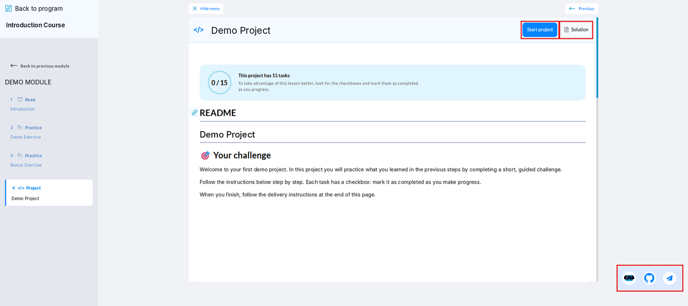
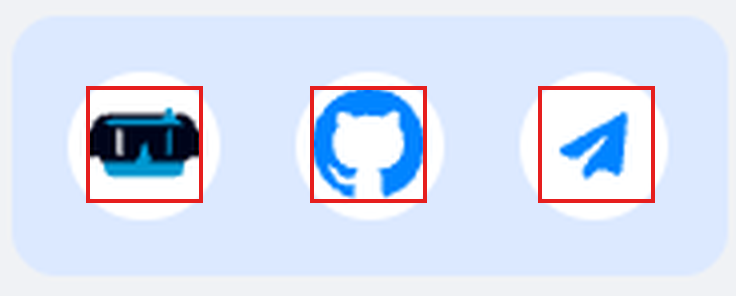

# El proyecto y Rigobot, tu apoyo para empezar

<!-- hide -->

_These instructions are also available in [English](https://github.com/4GeeksAcademy/ai-engineering-syllabus/blob/main/content/lessons/project-page-and-rigobot/project-page-and-rigobot.md)._

<!-- endhide -->

El proyecto es la parte más importante de cada módulo. En esta lección conocerás su pantalla, sus botones y cómo usar a Rigobot para arrancar con buen pie.

> **Nota sobre el idioma:** los nombres de los botones aparecen aquí tal como se ven en las capturas, en inglés. En tu pantalla pueden verse en el idioma de tu programa, pero su posición y su función son las mismas.

## Qué vas a lograr

- Ubicar las partes de la pantalla de un proyecto.
- Saber para qué sirve cada uno de los tres botones de la esquina inferior derecha.
- Usar a Rigobot para empezar tu proyecto.

## La pantalla de un proyecto

Al abrir un paso de tipo **Project** verás las instrucciones del proyecto (el README). Síguelas paso a paso: ahí se explica cómo empezar, qué tienes que construir y cómo entregarlo. Si quieres entender bien cada sección del README, revisa la lección [Cómo están estructurados los proyectos](https://learn.4geeks.com/es/lesson/how-projects-are-structured-es).

### Sobre el botón Solution

Arriba a la derecha encontrarás el botón **Solution**, que te permite ver una solución del proyecto. Úsalo con criterio: lo más provechoso es intentar el proyecto primero, pedir pistas a Rigobot si te atascas y consultar la solución después, para comparar tu trabajo con otra forma de resolverlo.

## Los tres botones de la esquina inferior derecha

En la esquina inferior derecha de la pantalla hay tres botones redondos:

1. **Rigobot:** abre el chat con tu asistente de inteligencia artificial.
2. **Repositorio (icono de GitHub):** abre el repositorio original del proyecto, para que puedas verlo.
3. **Avión de papel:** abre la ventana de entrega. Lo usarás cuando termines el proyecto.

## Rigobot: tu apoyo para empezar

Rigobot es el asistente de inteligencia artificial de 4Geeks. Es el mismo que te acompaña en las prácticas, y en el proyecto puedes preguntarle sobre lo que te pide el proyecto.

La mejor forma de usarlo es como apoyo para **empezar**, no para resolver el proyecto por ti. Puede darte pistas y ayudarte a entender por dónde comenzar. Para desarrollar el proyecto, apóyate en tu agente de código siguiendo las fases **Ask → Plan → Agent** que verás en [Cómo están estructurados los proyectos](https://learn.4geeks.com/es/lesson/how-projects-are-structured-es).

### Ejemplos de preguntas útiles

- "No entiendo lo que pide el primer paso. ¿Me lo explicas con otras palabras?"
- "¿Por dónde me recomiendas empezar este proyecto?"
- "¿Cómo puedo dividir este proyecto en pasos pequeños?"
- "¿Qué concepto debería repasar para entender esta tarea?"

### Cómo hacer buenas preguntas

- Cuenta en qué parte del proyecto estás.
- Explica qué quieres lograr o entender.
- Cuenta qué has intentado hasta ahora.

## Cuando Rigobot no es suficiente

Si sigues bloqueado, pide ayuda en el canal de soporte de tu programa en Slack. Incluye lo mismo: dónde estás, qué buscas y qué has intentado.

## Siguiente paso

Cuando termines tu proyecto, sigue con [Cómo entregar tu proyecto](https://learn.4geeks.com/es/lesson/how-to-deliver-your-project-es).
