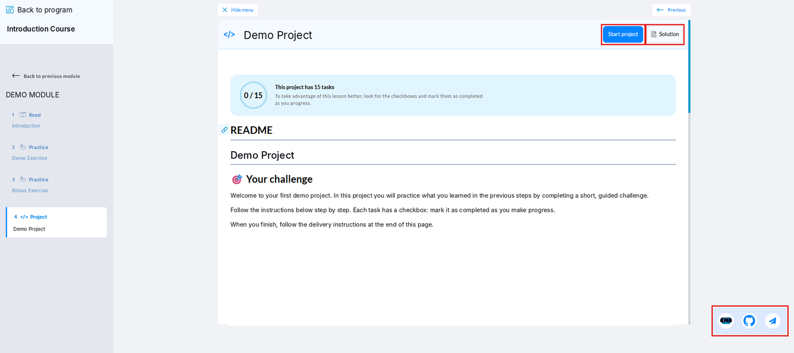
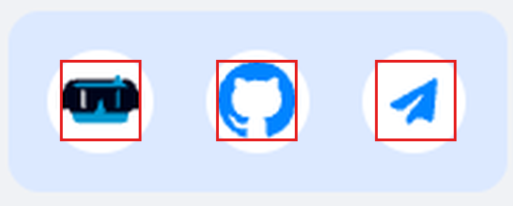

# The project and Rigobot, your help to get started

<!-- hide -->

_Estas instrucciones también están disponibles en [español](https://github.com/4GeeksAcademy/ai-engineering-syllabus/blob/main/content/lessons/project-page-and-rigobot/project-page-and-rigobot.es.md)._

<!-- endhide -->

The project is the most important part of every module. In this lesson you'll get to know its page, its buttons, and how to use Rigobot to get off to a good start.

> **A note on language:** button names appear here as they show up in the screenshots, in English. On your screen they may appear in your program's language, but their position and function are the same.

## What you will achieve

- Find your way around a project's page.
- Know what each of the three buttons in the bottom-right corner is for.
- Use Rigobot to get your project started.

## A project's page

When you open a **Project** step, you'll see the project's instructions (the README). Follow them step by step: they explain how to start, what you need to build, and how to submit it. To understand each section of the README well, check the lesson [How projects are structured](https://learn.4geeks.com/lesson/how-projects-are-structured).

### About the Solution button

At the top right you'll find the **Solution** button, which lets you see a solution to the project. Use it wisely: the most useful approach is to try the project first, ask Rigobot for hints if you get stuck, and check the solution afterward to compare your work with another way of solving it.

## The three buttons in the bottom-right corner

In the bottom-right corner of the screen there are three round buttons:

1. **Rigobot:** opens the chat with your AI assistant.
2. **Repository (GitHub icon):** opens the project's original repository so you can look at it.
3. **Paper plane:** opens the submission window. You'll use it when you finish the project.

## Rigobot: your help to get started

Rigobot is 4Geeks' AI assistant. It's the same one that helps you in the practices, and in the project you can ask it about what the project asks you to do.

The best way to use it is as support to **get started**, not to solve the project for you. It can give you hints and help you understand where to begin. To build the project, rely on your coding agent following the **Ask → Plan → Agent** phases you'll see in [How projects are structured](https://learn.4geeks.com/lesson/how-projects-are-structured).

### Examples of useful questions

- "I don't understand what the first step asks. Can you explain it in other words?"
- "Where do you recommend I start this project?"
- "How can I break this project down into small steps?"
- "Which concept should I review to understand this task?"

### How to ask good questions

- Say which part of the project you're on.
- Explain what you want to achieve or understand.
- Share what you've tried so far.

## When Rigobot isn't enough

If you're still stuck, ask for help in your program's support channel on Slack. Include the same things: where you are, what you're looking for, and what you've tried.

## Next step

When you finish your project, continue with [How to deliver your project](https://learn.4geeks.com/lesson/how-to-deliver-your-project).
