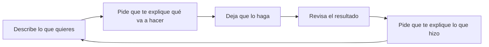

# 🧭 Por qué 4Geeks empieza con Cline

<!-- hide -->

_These instructions are also available in [English](https://github.com/4GeeksAcademy/ai-engineering-syllabus/blob/main/content/lessons/why-4geeks-starts-with-cline/why-4geeks-starts-with-cline.md)._

<!-- endhide -->

Le pides a una herramienta de IA que te haga una página web. En unos segundos crea varios archivos, instala cosas y te enseña la página funcionando. Genial. Pero cuando alguien te pregunta cómo lo hizo, no sabes qué responder: la herramienta hizo todo y tú solo miraste.

Eso es lo que 4Geeks quiere evitar en tus primeras semanas con IA. Cline es un agente de código: un asistente que no solo conversa contigo, sino que también trabaja en tu computadora. En esta lección verás qué es Cline, por qué empezamos con él y unos hábitos sencillos para que aprendas mientras te ayuda.

## Qué es Cline

Seguramente ya has usado un chat de IA: le haces una pregunta y te responde con texto. Cline va un paso más allá. Le describes una tarea con tus palabras y Cline la hace por ti: puede leer archivos, crear archivos nuevos, cambiarlos y ejecutar comandos en tu computadora.

Por eso decimos que es un **agente**: no solo responde, también actúa.

Cline existe en varias versiones. En este curso usas la **app de escritorio** (Cline Desktop), que se instala como cualquier otro programa. Más adelante podrás usarlo también dentro de un editor de código como VS Code o desde la terminal. Lo que aprendas ahora te servirá en todas.

## Por qué Cline

### Es open source

El código de Cline es público: cualquiera puede verlo en GitHub. Eso significa que no es una caja cerrada. Cuando en el curso estudies cómo funcionan los agentes por dentro, podrás reconocer lo que ya usaste.

### Tú eliges el modelo

Cline no viene atado a una sola inteligencia artificial. Tú decides con qué modelo trabaja usando tu propia API key (una especie de contraseña para usar modelos de IA). 4Geeks te da una key con un presupuesto mensual que te permite usar varios modelos, y Cline la acepta.

Si en el futuro cambias de modelo, tu forma de trabajar con Cline sigue siendo la misma.

### Sabes a dónde va tu información

Cline funciona en tu computadora. Cuando le escribes, tu mensaje viaja directamente al modelo que elegiste a través de 4Geeks, no a un servicio que no conoces.

## Cline actúa por su cuenta

Esto es lo más importante de la lección: en la app de escritorio, **Cline no te pide permiso antes de la mayoría de sus acciones**. Si le pides algo, puede crear o borrar archivos y ejecutar comandos directamente.

Eso lo hace rápido, pero también significa que tú tienes que poner los límites. Sigue estas reglas:

- **Trabaja siempre en una carpeta propia para cada práctica**, por ejemplo `cline-test` o la carpeta de tu proyecto. Nunca abras con Cline carpetas con documentos personales, fotos o trabajos importantes.
- **Dile qué no debe hacer.** Por ejemplo: "No borres nada" o "Solo trabaja dentro de esta carpeta".
- **No compartas datos sensibles** en la conversación: contraseñas, datos bancarios o información personal.

## Cómo aprender con Cline

Que Cline haga el trabajo no significa que tú aprendas. Usa este ciclo en cada tarea:

1. **Describe lo que quieres** con tus palabras, lo más claro posible.
2. **Pide que te explique antes de hacerlo.** Por ejemplo: "Antes de hacer nada, explícame en pasos sencillos qué vas a hacer". Si algo no te convence, díselo.
3. **Deja que lo haga** cuando el plan tenga sentido para ti.
4. **Revisa el resultado.** Abre los archivos que creó, mira la página o prueba lo que hizo. ¿Es lo que pediste?
5. **Pide que te explique lo que hizo**, como si se lo explicara a alguien que está empezando. Si no lo entiendes, pregúntale otra vez con otras palabras.

No pasa nada si al principio no entiendes todo el código. Lo importante es que entiendas **qué** hizo Cline y **para qué**. Leer y escribir código lo irás aprendiendo durante el curso.

## Checklist para trabajar con Cline

- [ ] Puedes explicar con tus palabras qué es un agente de código y en qué se diferencia de un chat de IA.
- [ ] Sabes qué modelo estás usando en cada sesión.
- [ ] Trabajas en una carpeta propia para cada práctica, nunca en carpetas con archivos personales.
- [ ] Antes de cada tarea, le pediste a Cline que te explicara qué iba a hacer.
- [ ] Revisaste el resultado y comprobaste que era lo que pediste.
- [ ] Puedes contar con tus palabras qué hizo Cline y para qué.

## Conclusión

4Geeks empieza con Cline porque es abierto, te deja elegir el modelo y te ayuda a trabajar con IA desde el primer día. Como actúa por su cuenta, tú pones los límites: una carpeta propia, instrucciones claras y ningún dato sensible. Y para que el aprendizaje se quede contigo, pídele siempre que te explique qué va a hacer y qué hizo. La herramienta cambiará con el tiempo, pero ese hábito te servirá siempre.

Ver también: [Cómo obtener una API key de LLM en 4Geeks](https://learn.4geeks.com/es/lesson/how-to-get-llm-api-key-4geeks-es) e [Instala Cline Desktop y conéctalo a los modelos de 4Geeks](https://learn.4geeks.com/es/lesson/install-cline-desktop-4geeks-models-es).
