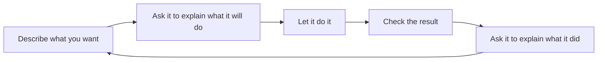

# 🧭 Why 4Geeks starts with Cline

<!-- hide -->

_Estas instrucciones también están disponibles en [español](https://github.com/4GeeksAcademy/ai-engineering-syllabus/blob/main/content/lessons/why-4geeks-starts-with-cline/why-4geeks-starts-with-cline.es.md)._

<!-- endhide -->

You ask an AI tool to build you a web page. In a few seconds it creates several files, installs a few things and shows you the page working. Great. But when someone asks you how it did it, you have no answer: the tool did everything and you only watched.

That is what 4Geeks wants to avoid in your first weeks with AI. Cline is a coding agent: an assistant that does not just chat with you, it also works on your computer. In this lesson you will see what Cline is, why we start with it and a few simple habits so you learn while it helps you.

## What Cline is

You have probably used an AI chat already: you ask a question and it answers with text. Cline goes one step further. You describe a task in your own words and Cline does it for you: it can read files, create new files, change them and run commands on your computer.

That is why we call it an **agent**: it does not only answer, it also acts.

Cline comes in several versions. In this course you use the **desktop app** (Cline Desktop), which you install like any other program. Later you will also be able to use it inside a code editor like VS Code or from the terminal. What you learn now will help you in all of them.

## Why Cline

### It is open source

Cline's code is public: anyone can see it on GitHub. That means it is not a closed box. When you study how agents work on the inside later in the course, you will recognize what you already used.

### You choose the model

Cline is not tied to a single artificial intelligence. You decide which model it works with by using your own API key (a kind of password to use AI models). 4Geeks gives you a key with a monthly budget that lets you use several models, and Cline accepts it.

If you change models in the future, the way you work with Cline stays the same.

### You know where your information goes

Cline runs on your computer. When you write to it, your message goes straight to the model you chose through 4Geeks, not to a service you do not know.

## Cline acts on its own

This is the most important part of the lesson: in the desktop app, **Cline does not ask for your permission before most of its actions**. If you ask for something, it can create or delete files and run commands right away.

That makes it fast, but it also means you are the one who sets the limits. Follow these rules:

- **Always work in a separate folder for each practice**, for example `cline-test` or your project folder. Never open folders with personal documents, photos or important work with Cline.
- **Tell it what it must not do.** For example: "Do not delete anything" or "Only work inside this folder".
- **Do not share sensitive data** in the conversation: passwords, bank details or personal information.

## How to learn with Cline

Cline doing the work does not mean you are learning. Use this cycle in each task:

1. **Describe what you want** in your own words, as clearly as you can.
2. **Ask it to explain before it acts.** For example: "Before you do anything, explain in simple steps what you are going to do". If something does not convince you, tell it.
3. **Let it do it** once the plan makes sense to you.
4. **Check the result.** Open the files it created, look at the page or try what it did. Is it what you asked for?
5. **Ask it to explain what it did**, as if it were explaining it to someone who is just starting. If you do not understand, ask again in other words.

It is fine if at first you do not understand all the code. What matters is that you understand **what** Cline did and **why**. You will learn to read and write code during the course.

## Checklist for working with Cline

- [ ] You can explain in your own words what a coding agent is and how it differs from an AI chat.
- [ ] You know which model you are using in each session.
- [ ] You work in a separate folder for each practice, never in folders with personal files.
- [ ] Before each task, you asked Cline to explain what it was going to do.
- [ ] You checked the result and confirmed it was what you asked for.
- [ ] You can tell in your own words what Cline did and why.

## Conclusion

4Geeks starts with Cline because it is open, it lets you choose the model and it helps you work with AI from day one. Since it acts on its own, you set the limits: a separate folder, clear instructions and no sensitive data. And so the learning stays with you, always ask it to explain what it is going to do and what it did. The tool will change over time, but that habit will always be useful.

See also: [How to get an LLM API key in 4Geeks](https://learn.4geeks.com/lesson/how-to-get-llm-api-key-4geeks) and [Install Cline Desktop and connect it to the 4Geeks models](https://learn.4geeks.com/lesson/install-cline-desktop-4geeks-models).
