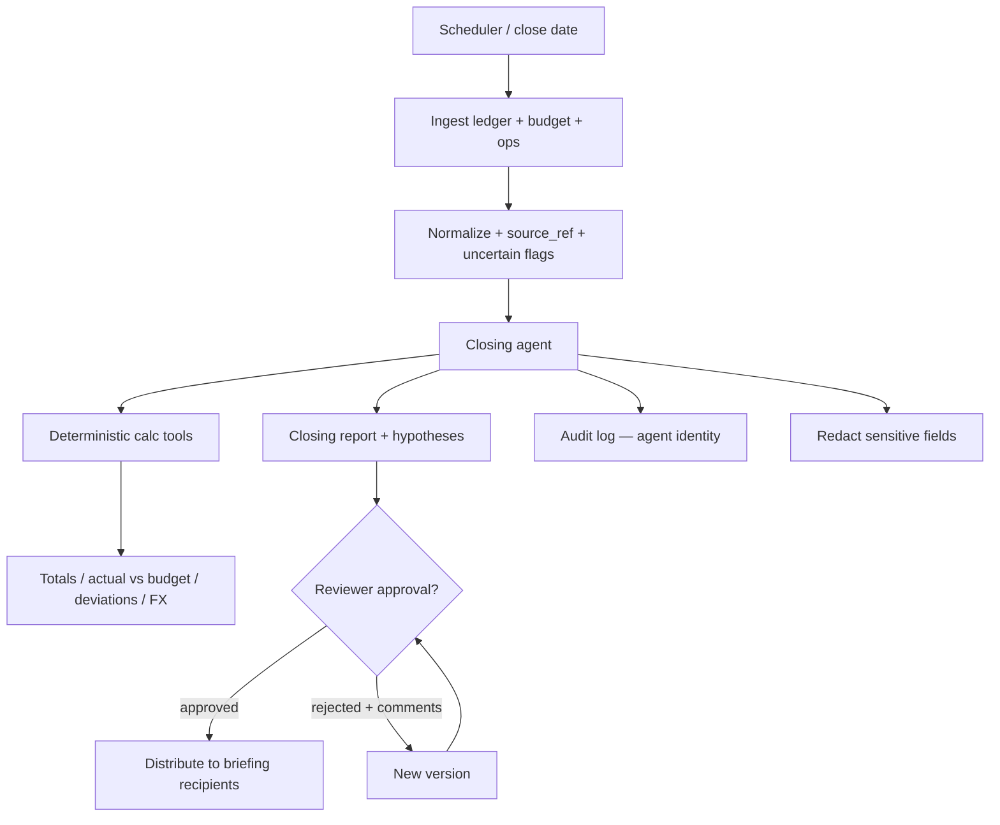

# Agentic Engineering – Monthly Financial Close — Reference Solution

Reference quality bar for the student's company monorepo fork. Thresholds, currencies, report breakdown, reviewer, and recipients below are **indicative** — students must align exactly with their assigned briefing under `content/contexts/financial-close/`.

---

## Architecture overview



**Design invariants:**

1. **Traceability** — every figure in the report points to source records (`source_ref`); the reviewer can look up any number.
2. **Deterministic math** — totals, actual vs budget, absolute/percentage deviation, and currency conversion (if required) live in tested code tools; the model never invents arithmetic.
3. **Honest incompleteness** — missing or uncertain data is declared in the report; never filled in by eye.
4. **Human decides distribution** — agent prepares; distribution only after the briefing reviewer approves; rejection with comments produces a new version.
5. **Least-privilege agent identity** — agent has its own identity and read-only access to financial data; actions logged as automated process; sensitive fields never appear in logs, stored prompts, or outbound messages.

---

## Expected file layout (indicative)

| Area            | Path (indicative)                   | Purpose                                          |
| --------------- | ----------------------------------- | ------------------------------------------------ |
| Ingestion       | `data/pipelines/financial_close.py` | CSV/API sources → normalized rows + `source_ref` |
| Calc tools      | `services/close/calc_tools.py`      | Pure functions + unit tests                      |
| Closing agent   | `services/close/agent.py`           | Tool loop, deviation pick, hypothesis write-up   |
| Report          | `services/close/report.py`          | Structure/breakdown from briefing                |
| Scheduler       | `services/close/scheduler.py`       | Background run on briefing close date            |
| Approvals       | `services/close/approvals.py`       | HITL gate by briefing reviewer                   |
| Distribution    | `services/close/distribution.py`    | Send only after approval to briefing recipients  |
| Audit / privacy | `services/close/audit.py`           | Agent logs; redaction                            |
| Tests           | `tests/close/`                      | Tools, idempotent figures, missing data, HITL    |

---

## Deterministic calculation tools

| Tool                           | Input (min)                   | Output (min)                                       |
| ------------------------------ | ----------------------------- | -------------------------------------------------- |
| `sum_by_dimensions`            | rows, group keys              | totals with `source_refs[]`                        |
| `actual_vs_budget`             | actual, budget, keys          | absolute + `%` deviation per key                   |
| `flag_above_threshold`         | deviations, threshold_pct     | list of keys that breach (both directions if req.) |
| `convert_currency` (if needed) | amount, from, to, rate_source | converted amount + rate `source_ref`               |

### Example: deviation row (indicative)

```json
{
  "country": "US",
  "service": "last_mile",
  "category": "revenue",
  "budget": 260000.0,
  "actual": 248000.0,
  "deviation_abs": -12000.0,
  "deviation_pct": -4.6,
  "above_threshold": false,
  "threshold_pct": 5.0,
  "source_refs": [
    "ledger:entry_us_lm_001",
    "ledger:entry_us_lm_002",
    "budget:US:last_mile:revenue:2026-03"
  ]
}
```

---

## Closing agent

- Call calc tools; never compute sums/percentages in the prompt.
- Identify deviations that exceed the briefing threshold (including favorable surprises if the briefing requires both directions).
- For each relevant deviation: write a **hypothesis** grounded in ledger/ops data, citing the supporting figures and `source_ref`s.
- Emit the report with the briefing's sections and breakdown.
- If any required series is missing or marked `uncertain`, say so explicitly in the report.

### Example: report fragment (indicative)

```json
{
  "period": "2026-03",
  "currency_report": "EUR",
  "sections": [
    {
      "title": "Revenue by country and service",
      "rows": ["…"],
      "missing": []
    }
  ],
  "deviations": [
    {
      "key": "ES:reverse_logistics:revenue",
      "deviation_pct": 15.0,
      "hypothesis": "Volume spike on returns contracts; see operations metric returns_orders.",
      "supporting_refs": [
        "ops:ES:reverse:returns_orders:2026-03",
        "ledger:es_rev_014"
      ]
    }
  ],
  "incomplete": ["carrier_fuel_surcharge:ES:missing_week_4"],
  "status": "pending_review",
  "reviewer_role": "finance_ops_lead"
}
```

---

## Review, distribution, security

- Schedule the close for the briefing date/timezone; run as a background task.
- Send draft to the briefing reviewer before any distribution.
- Approve → distribute only to briefing recipients; reject + comments → new version that addresses them.
- Log `actor_type=agent` + agent identity; never log sensitive briefing fields (e.g. account numbers, personal emails if marked sensitive).

---

## Validation checklist (maps to README evaluation)

- [ ] Every figure → source records; reviewer can look up any number
- [ ] Calc tools covered by unit tests; LLM does not invent arithmetic
- [ ] Same period + same data → identical figures on re-run
- [ ] Threshold deviations detected; each has a data-backed hypothesis
- [ ] Incomplete period → report states what is missing
- [ ] No distribution without reviewer approval; rejection produces a new version
- [ ] Agent actions logged as automated process
- [ ] Sensitive data absent from logs, stored prompts, outbound messages

---

## What “done” looks like in the PR

Report structure, list of calculation tools, one sample closing report with full traceability, one sample with incomplete data, and evidence of HITL + redaction — all aligned to the assigned `content/contexts/financial-close/` briefing.
