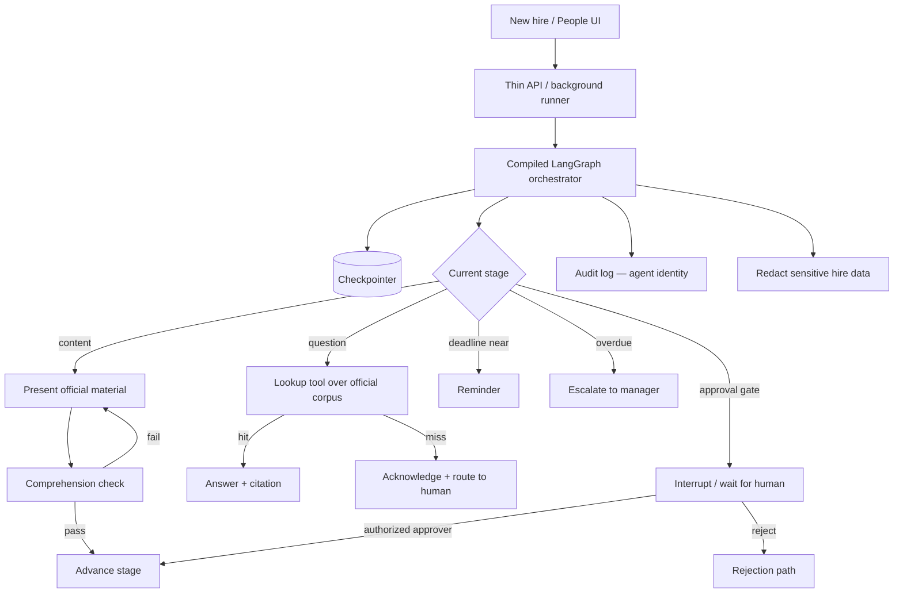

# Agentic Engineering – Onboarding Agent — Reference Solution

Reference quality bar for the student's company monorepo fork. Stage names, deadlines, approvers, and document types below are **indicative** — students must align exactly with their assigned briefing under `content/contexts/onboarding-orchestrator/`.

---

## Architecture overview



**Design invariants:**

1. **One orchestrator agent** with an explicit stage graph — not a fleet of specialist agents for this sequential, long-running process.
2. **Durable state** via a checkpointer: resume mid-onboarding after process restart with the same `thread_id` / onboarding id.
3. **Content stages never complete** without a passed comprehension check.
4. **Answers only from indexed official material**; uncovered questions are acknowledged and routed — never invented.
5. **Human approvals are true interrupts** (e.g. LangGraph interrupt / human-in-the-loop); only the role named in the briefing may unblock.
6. **Agent identity** is distinct and least-privilege; every action is logged as automated; sensitive hire fields never appear in logs, stored prompts, or outbound messages.

---

## Expected file layout (indicative)

| Area         | Path (indicative)                   | Purpose                                                  |
| ------------ | ----------------------------------- | -------------------------------------------------------- |
| Stage graph  | `services/onboarding/graph.py`      | Nodes, edges, compile + checkpointer                     |
| State        | `services/onboarding/state.py`      | Onboarding id, stage, check results, pending approval    |
| Corpus / RAG | `data/pipelines/onboarding_docs.py` | Index + retrieve from briefing material                  |
| Tools        | `services/onboarding/tools.py`      | Lookup, notify, escalate — no unauthorized tools         |
| Approvals    | `services/onboarding/approvals.py`  | Interrupt, role/dept check, reject path                  |
| Jobs         | `services/onboarding/worker.py`     | Background runner (not request-response only)            |
| Views        | `uis/` or API read models           | People dashboard + new-hire progress                     |
| Tests        | `tests/onboarding/`                 | Resume-after-restart, check gate, RAG miss, approval ACL |

---

## Stage graph (must match briefing)

Minimum content coverage from the student README: company, operations, role functions, ways of working, guidelines, plus administrative stages (documents, access, signatures) and any briefing-specific gates (e.g. site visit).

Each stage needs:

| Field           | Requirement                                                              |
| --------------- | ------------------------------------------------------------------------ |
| Entry condition | Prior stage complete (and approvals if any)                              |
| Exit condition  | Check passed, documents marked received, or named human confirmed        |
| Deadline        | Business days from start per briefing                                    |
| Approver        | `automatic` \| named role (People, direct manager, warehouse manager, …) |

---

## Persistence and resume

```python
# Indicative — framework APIs vary
graph = builder.compile(checkpointer=checkpointer)

config = {"configurable": {"thread_id": onboarding_id}}
# After crash/restart: same thread_id resumes at last checkpointed stage
graph.invoke(None, config=config)  # or update_state + invoke
```

**Acceptance evidence:** test kills/restarts the process mid-stage; next invoke resumes at the same stage without replaying completed checks.

---

## Comprehension checks and RAG

- Present role-adapted content for the current stage.
- Closing a content stage requires a passed check; failure → reinforce → re-check.
- Lookup tool returns passages with source ids; agent cites them.
- Out-of-corpus question → explicit “not in official material” + route to the person named in the briefing (e.g. Head of People).

### Example: out-of-corpus routing (indicative)

```json
{
  "answer": null,
  "status": "routed",
  "reason": "not_in_official_material",
  "routed_to": "head_of_people",
  "question": "Can I expense a home standing desk before day 30?"
}
```

---

## Human approvals

- Graph pauses at approval nodes; no silent auto-approve.
- Validate approver role **and** department/relationship (e.g. direct manager of that hire).
- Rejection path is explicit (return to prior stage, notify People, or briefing-defined branch).

---

## Follow-up, escalation, views

- Reminders when a stage approaches its deadline.
- Escalation to direct manager when overdue.
- People view: active onboardings, current stage, blocked items.
- New-hire view: own progress and remaining work.

---

## Security and traceability

- Agent service account with narrower permissions than any human role.
- Structured audit log fields: `actor_type=agent`, `actor_id`, `action`, `onboarding_id`, `stage` — never raw contract text or national ID.
- Redact sensitive fields in prompts, checkpoints metadata, and notifications.

---

## Validation checklist (maps to README rubric)

- [ ] Explicit graph covers company, operations, role, ways of working, guidelines, and administrative steps from the briefing
- [ ] Resume-after-restart test passes
- [ ] No content stage completes without a passed check
- [ ] Cited answers from corpus; out-of-corpus routed
- [ ] Approval interrupt + role ACL; rejection handled
- [ ] Overdue stage escalates to direct manager
- [ ] Agent actions logged as automated
- [ ] Sensitive hire data absent from logs / stored prompts / outbound messages
- [ ] Written justification for single-agent architecture in the PR

---

## Common mistakes

| Mistake                                                  | Why it fails                                                 |
| -------------------------------------------------------- | ------------------------------------------------------------ |
| Generic stage list ignoring the briefing                 | Stages/approvers/deadlines must match the assigned company   |
| Multi-agent split “for cleanliness” without defending it | README requires defending the single sequential orchestrator |
| Completing a stage on “opened document”                  | Understanding check is mandatory                             |
| LLM inventing policy answers                             | Violates official-material-only rule                         |
| Auto-skipping manager approval                           | Human gates are real interrupts                              |
| Logging contract / PII in traces                         | Sensitive-data rubric fails                                  |
