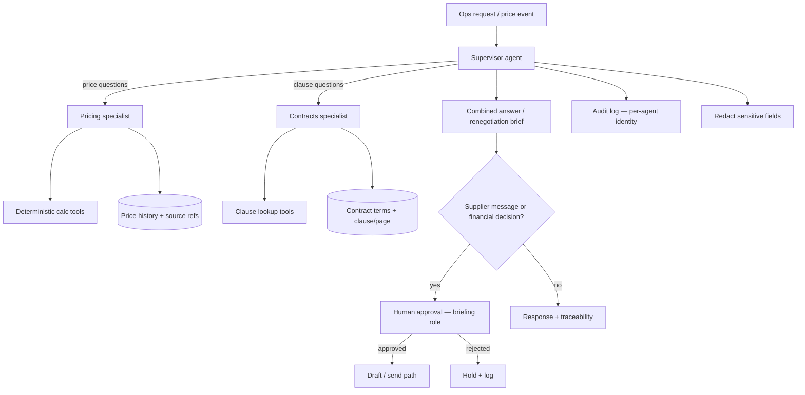

# Agentic Engineering – Supplier and Contract Management — Reference Solution

Reference quality bar for the student's company monorepo fork. Supplier IDs, thresholds, alert lead times, currencies, and approvers below are **indicative** — students must align exactly with their assigned briefing under `content/contexts/supplier-contracts/`.

---

## Architecture overview



**Design invariants:**

1. **Supervisor + specialists** — pricing and contracts are distinct specialties with separate tools and I/O contracts; the supervisor routes and merges, and caps consultations per request to avoid loops.
2. **Traceability** — every figure points to a source record; every contractual claim cites clause + page (or explicit “missing”).
3. **Deterministic math** — deltas, impact, comparisons, and currency conversion (if briefing requires it) live in tested code tools; the model never invents arithmetic.
4. **Human decides** — no supplier communication and no financial-impact decision executes without the approver named in the briefing.
5. **Least-privilege agent identity** — each agent has its own identity and only its specialty’s tools; actions are logged with which agent acted; sensitive fields never appear in logs, stored prompts, or outbound messages.

---

## Expected file layout (indicative)

| Area            | Path (indicative)                       | Purpose                                             |
| --------------- | --------------------------------------- | --------------------------------------------------- |
| Supervisor      | `services/suppliers/supervisor.py`      | Route, merge, consultation budget, brief assembly   |
| Pricing agent   | `services/suppliers/pricing_agent.py`   | History, threshold alerts, impact, peer comparison  |
| Contracts agent | `services/suppliers/contracts_agent.py` | Clause Q&A, revision fit, expiry/notice alerts      |
| Calc tools      | `services/suppliers/calc_tools.py`      | Pure functions + unit tests                         |
| Ingestion       | `data/pipelines/suppliers.py`           | Registry + price history with source refs           |
| PDF extraction  | `data/pipelines/contracts_pdf.py`       | Terms + clause/page; low-confidence → `uncertain`   |
| Approvals       | `services/suppliers/approvals.py`       | HITL gate by briefing role/threshold                |
| Audit / privacy | `services/suppliers/audit.py`           | Per-agent logs; redaction                           |
| Tests           | `tests/suppliers/`                      | Threshold, clause fit, brief merge, HITL, no invent |

---

## Specialist contracts (must be explicit)

| Specialist | Receives (min)                                    | Returns (min)                                                                    |
| ---------- | ------------------------------------------------- | -------------------------------------------------------------------------------- |
| Pricing    | supplier/product ids, period, volumes, threshold  | deltas, impact, peer compare, each with `source_ref`; or `missing`               |
| Contracts  | supplier/contract id, situation (e.g. proposed %) | allowed/not, clause+page, notice/exit/penalty excerpts; or `uncertain`/`missing` |
| Supervisor | natural-language or event payload                 | merged answer or renegotiation brief + consultation count ≤ budget               |

---

## Pricing specialist

- Maintain history by supplier and product/service.
- Alert when increase ≥ briefing threshold (component-aware if the briefing splits rates).
- Impact = deterministic function of volume × delta (and FX if required).
- Compare peers in the same category (and country/currency rules from the briefing).

### Example: threshold hit (indicative)

```json
{
  "supplier_id": "TF-S01",
  "product": "base_rate_per_shipment",
  "old_price": 4.2,
  "new_price": 4.7,
  "delta_pct": 11.9,
  "threshold_pct": 5.0,
  "alert": true,
  "impact_monthly": 1850.0,
  "source_ref": "price_history:TF-S01:2026-03-01",
  "peers": [
    {
      "supplier_id": "TF-S02",
      "price": 4.35,
      "source_ref": "price_history:TF-S02:2026-03-01"
    }
  ]
}
```

---

## Contracts specialist

- Answer what the contract allows/forbids for a concrete situation, citing clause + page.
- Decide whether a proposed increase fits the price-revision clause (and notice requirements).
- Fire expiry / notice alerts with the briefing lead time.
- Low-confidence PDF extraction → `uncertain`, never treated as validated fact.

### Example: revision clause check (indicative)

```json
{
  "supplier_id": "TF-S01",
  "proposed_increase_pct": 11.9,
  "allowed": false,
  "reason": "exceeds_revision_cap",
  "clause_id": "4.2",
  "page": 7,
  "notice_on_record": false,
  "confidence": "high"
}
```

---

## Supervisor

- Choose which specialists to call; combine into one response.
- On threshold alert: automatically ask contracts about allowance + pricing about impact.
- On request: produce a renegotiation brief (history, peers, impact, contractual leverage).
- Hard-cap specialist calls per request (e.g. ≤ N) to prevent consultation loops.

### Example: renegotiation brief skeleton (indicative)

```json
{
  "supplier_id": "TF-S01",
  "recommendation": "renegotiate_or_exit",
  "pricing": {
    "delta_pct": 11.9,
    "impact_monthly": 1850.0,
    "peers": ["TF-S02"]
  },
  "contract": {
    "revision_allowed": false,
    "notice_days": 60,
    "exit_clause": "8.1",
    "page": 12
  },
  "missing": ["written_increase_notice"],
  "traceability": [
    "price_history:TF-S01:2026-03-01",
    "contract:TF-S01:p7:c4.2"
  ],
  "consultations": 2
}
```

---

## Human approval and security

- Drafts of supplier messages are allowed; send path blocked until the briefing approver acts.
- Apply briefing thresholds (who approves packaging vs carriers vs large contracts).
- Log `actor_type=agent` + `agent_id`; never log sensitive briefing fields in prompts or messages.

---

## Validation checklist (maps to README evaluation)

- [ ] Supervisor + specialists with documented I/O contracts and tools
- [ ] Increase above threshold detected and evaluated against revision clause
- [ ] Renegotiation brief merges both specialists coherently
- [ ] Every figure → source record; every claim → clause + page (or explicit missing)
- [ ] Calc tools covered by unit tests; LLM does not invent arithmetic
- [ ] Expiry/notice alerts honor briefing lead times
- [ ] No supplier communication without correct human approver
- [ ] Missing data/clauses stated; never invented
- [ ] Sensitive data absent from logs, stored prompts, outbound messages
- [ ] Written justification for multi-agent (vs one mega-agent)

---

## What “done” looks like in the PR

Architecture diagram, specialist I/O contracts, multi-agent justification, one detected increase evaluated against its contract, one renegotiation brief with full traceability, and evidence of HITL + redaction.
